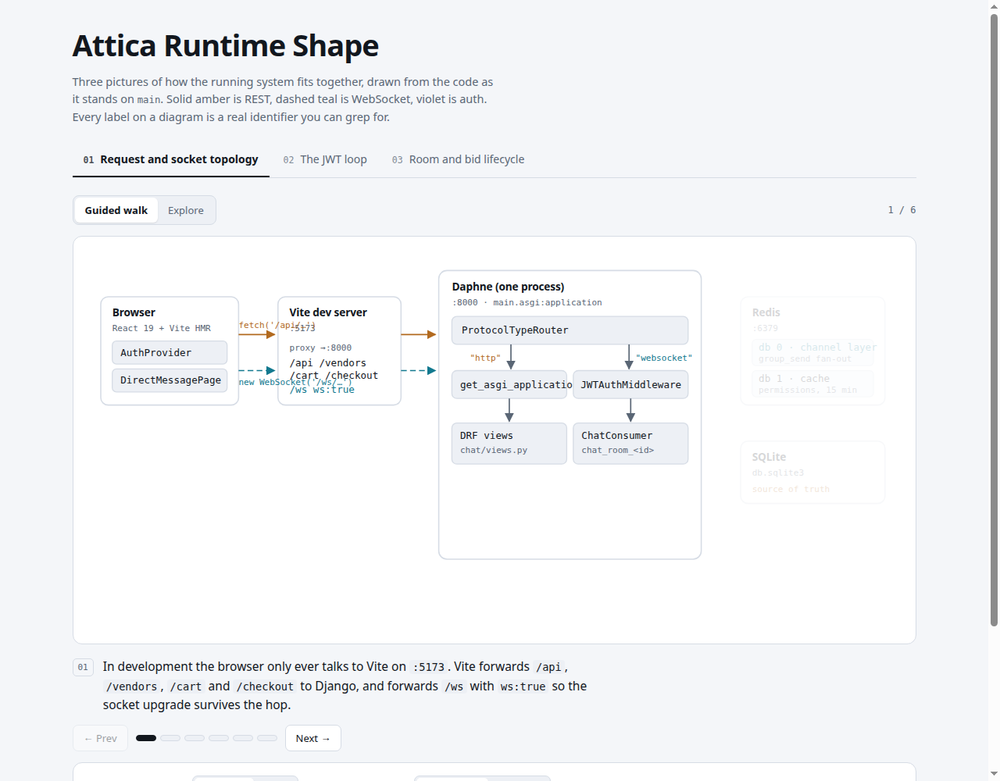
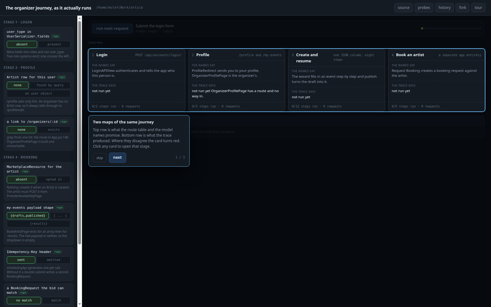

# How does Attica actually work, once you have been away from it?

Screenshots taken from the interactive scenes in
[`../../scenes/how-attica-actually-works/`](../../scenes/how-attica-actually-works/), kept so the
pictures are readable without running anything.

## What is in here

One standalone figure, and one set of five walkthrough frames.

## The figures

### request-and-socket-topology

**What it shows**

The four processes behind one "hit save": the browser, the Vite dev server on `:5173`, Daphne on
`:8000` carrying both `get_asgi_application` and `JWTAuthMiddleware` under one
`ProtocolTypeRouter`, and Redis and SQLite drawn faded because this frame does not exercise them.
Solid amber is REST, dashed teal is WebSocket, violet is auth. Every label is a real identifier you
can grep for.

**How we got this image**

A screenshot of the `attica-runtime-topology` scene, tab 1 ("Request and socket topology"), first
frame of its guided walk, captured 2026-08-15.

**What it lets you say**

In development the browser only ever talks to Vite on `:5173`. Vite forwards `/api`, `/vendors`,
`/cart` and `/checkout` to Django, and forwards `/ws` with `ws: true`, so the socket upgrade
survives the hop.

**What it cannot say**

Nothing about production, and nothing about the paths this frame greys out. It is one of six frames
in one of three tabs.

**Where it came from and what judged it**

`frontend/vite.config.js` and `backend/main/main/routing.py`, by way of the scene.
It corroborates a fact in [`../../../environment/overview.md`](../../../environment/overview.md): the `/ws` proxy rule
exists and works, contradicting a claim in the learning journey's flow map that said it did not.
**Held since 2026-08-22.** No plan names it; kept because it is the cheapest available proof of
that correction.

## The sets

### organizer-journey-walkthrough

**The question.** What does one organizer actually do, and what does the system actually do back?

**How it is sorted.** Five frames in walk order, `j0` through `j4`, following the organizer from
login to booking an artist.

**How many cells.** Five.

**One example.**

**How we got these images**

Screenshots of the `attica-organizer-journey` scene, captured 2026-08-15 while walking its guided
route.

**What they cannot say**

They are frames of a scene, not of the live application. What they show is the scene's rendering of
a trace, which was itself taken from the repository rather than from a running server.

**Where they came from and what judged them**

The scene in [`../../scenes/how-attica-actually-works/attica-organizer-journey/`](../../scenes/how-attica-actually-works/attica-organizer-journey/).
**Held since 2026-08-22.** No plan names this set.
