# Frontend Setup — Procedure Diagram

How the Attica React/Vite frontend goes from a fresh clone to a logged-in browser session.
One fork point: whether the backend is already running. Three decision gates: Node version,
proxy config, and login credentials. The Vite proxy is highlighted because it is the most
commonly misunderstood step.

```mermaid
flowchart TD
    START([Start\ngit clone done · backend on :8000\nNode 16+ installed])

    START --> CDFE[cd frontend]

    CDFE --> NODECHECK{node --version\n≥ 16?}

    NODECHECK -->|No| INSTALLNODE[Install Node 16+\nnodejs.org or nvm]
    NODECHECK -->|Yes| NPMI

    INSTALLNODE --> NPMI[Install dependencies\nnpm install\nReads package.json + package-lock.json\n→ creates node_modules/]

    NPMI --> PROXY[Inspect Vite proxy config\nopen frontend/vite.config.js]

    PROXY --> PROXYCHECK{Proxy entries\npresent?}

    PROXYCHECK -->|Missing| PROXYNOTE["Add to vite.config.js:\nproxy: {\n  '/api':     'http://localhost:8000',\n  '/vendors': 'http://localhost:8000',\n  '/cart':    'http://localhost:8000',\n  '/checkout':'http://localhost:8000',\n  '/ws':      { target: 'http://localhost:8000', ws: true }\n}"]
    PROXYCHECK -->|Present — no change needed| VITESTART

    PROXYNOTE --> VITESTART[Start Vite dev server\nnpm run dev\n→ http://localhost:5173\nHMR + proxy active]

    VITESTART --> BROWSER[Open browser\nhttp://localhost:5173]

    BROWSER --> CORSCHECK{Console errors?\nCORS / network fail?}

    CORSCHECK -->|Yes| CORSFIX["Backend not running or proxy misconfigured\n① Check: daphne running on :8000\n② Restart Vite: Ctrl+C → npm run dev"]
    CORSCHECK -->|No| LOGIN

    CORSFIX --> LOGIN

    LOGIN["Login\nUsername: e2e-organizer\nPassword: E2eOrganizerPass!23\n\nPOSTs to /api/accounts/token/\n(proxied → backend :8000)"]

    LOGIN --> LOGINCHECK{Login\nsucceeds?}

    LOGINCHECK -->|No — 401| SEEDFIX[Run on backend:\npython manage.py seed_e2e]
    LOGINCHECK -->|Yes| TOKENS

    SEEDFIX --> LOGIN

    TOKENS["Tokens stored in localStorage\nkey: 'tokens'\n{ access: '...jwt...', refresh: '...jwt...' }\n\nAccess token: 30 min\nRefresh token: 7 days"]

    TOKENS --> VERIFY["Verify in DevTools (F12)\n\nApplication → Local Storage → 'tokens'\nNetwork → API calls → 200 OK\nNetwork → each request has:\n  Authorization: Bearer <access_token>\nNetwork → WS tab → WebSocket connected"]

    VERIFY --> DONE([Frontend running\nlocalhost:5173\nLogged in · API + WebSocket working])
```



---

## Proxy Inset — Why This Step Exists

```
WITHOUT proxy:                        WITH Vite proxy:

Browser (5173)                        Browser (5173)
  │                                     │
  ├─ fetch('/api/events/')              ├─ fetch('/api/events/')
  │                                     │        │
  │  ← CORS ERROR                       │   Vite dev server intercepts
  │    "blocked by CORS policy"         │   forwards to http://localhost:8000/api/events/
  │    (browser sees cross-origin       │        │
  │     5173 → 8000 request)            │   Django responds 200
  ✗                                     │        │
                                        │   Vite returns response to browser
                                        ✓   (browser only ever talks to :5173)
```

**The fix is already in `vite.config.js` — no code change is needed.** This step is
"inspect" not "configure". A new developer needs to understand it exists so they know
where to look when something breaks.

**The `/ws` proxy entry** is equally important: WebSocket connections to
`ws://localhost:5173/ws/chat/rooms/<id>/` are forwarded to `ws://localhost:8000/ws/...`
with `ws: true` enabling protocol upgrade. Without it, WebSocket connections fail silently
in the Channels consumer.

---

**Caption:** Frontend setup from a fresh clone. Two fork points: Node version check (install
if needed) and proxy presence (already correct in the repo). Two failure recovery loops:
CORS error → check backend/restart Vite; login failure → re-run seed_e2e. The linear spine
is: npm install → npm run dev → login → verify.
