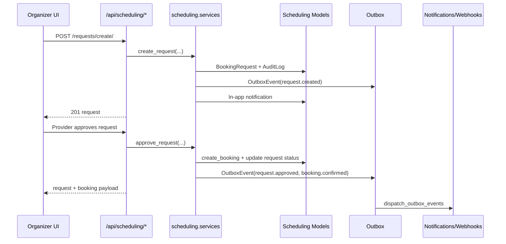

# API Design Review (Current State)

## Scope
This review is based on the current code in:
- `backend/main/main/urls.py`
- `backend/main/*/api_urls.py`, `backend/main/*/urls.py`
- `backend/main/*/views.py`, `services.py`, serializers/models where relevant
- `frontend/src/*` API consumers (direct `fetch`, `useAxios`, `schedulingApi`)

## Executive Summary
The API design is **mixed maturity**:

1. The **scheduling domain is carefully planned** and engineered with strong patterns: domain separation, service layer orchestration, [idempotency](../../../../../Obsidian/Information%20Technology/System%20Design/Reliability/Idempotency.md#where-to-learn-this)<sub>[1](../../../../../Obsidian/Mathematics/references/textbooks/system-design/system-design-interview.pdf#page=160 "System design interview, chapter 10, Design a notification system, Reliability, Works the duplicate-notification case: delivery cannot be exactly once, so ea..."), [2](../../../../../Obsidian/Mathematics/references/textbooks/system-design/system-design-big-archive.pdf#page=380 "System design big archive, How to Design Good APIs, Which HTTP methods are idempotent (GET, HEAD, PUT, DELETE) and which are not (POST, PATCH), then idempote..."), [3](../../../../../Obsidian/Mathematics/references/textbooks/system-design/system-design-big-archive.pdf#page=143 "System design big archive, A Cheatsheet on REST API Design Best Practices, Idempotent endpoints for safe retries, especially for POST, and idempotency keys t..."), [▶1](https://www.youtube.com/watch?v=m6DtqSb1BDM&t=673s "Arpit Bhayani, Build a robust Payments service using Idempotency Keys, Flow, 11:13 to 16:36, The flow of a payment request carrying an idempotency key, after..."), [▶2](https://www.youtube.com/watch?v=4OuaONkZw1I&t=68s "Hussein Nasser, Why Idempotency is very critical in Backend Applications, What is Idempotency, 1:08 to 7:12, What idempotency means for a backend request. Ch..."), [◆](../../../../../goal-setting/learning/system-design/foundations/textbook/02-the-api-contract-on-paper.md#23-the-idempotency-key-header "The API contract on paper, system-design/foundations, chapter 2, section 2.3. Works the three cases of `POST /payments` with an `Idempotency-Key`: a new key ...")</sub>, audit logs, [outbox](../../../../../Obsidian/Information%20Technology/System%20Design/Messaging/Outbox%20Pattern.md#where-to-learn-this)<sub>[▶1](https://www.youtube.com/watch?v=5YLpjPmsPCA&t=23s "Confluent, What is the Transactional Outbox Pattern? ∣ Designing Event-Driven Microservices, What is the dual-write problem?, 0:23 to 0:51, The problem the p..."), [▶2](https://www.youtube.com/watch?v=5YLpjPmsPCA&t=51s "Confluent, What is the Transactional Outbox Pattern?, What is the transactional outbox pattern?, 0:51 to 1:33, The pattern itself, before how its events reac..."), [◆](../../../../../goal-setting/learning/system-design/foundations/plans/19-outbox-queue-and-worker.md "The outbox, the queue and the worker, system-design/foundations, plan 19. The corner shop's order and an 'order placed' event written in one transaction, a r...")</sub>, DLQ, webhook/circuit-breaker controls, and deep tests.
2. The **platform-wide API surface is not fully unified**. There are parallel booking systems (`chat` and `scheduling`), inconsistent route/parameter conventions, duplicate route exposure, and uneven test coverage across apps.

Verdict: **partially carefully planned**.  
The newer scheduling architecture is deliberate and efficient. The overall API ecosystem still reflects iterative growth and needs consolidation for long-term efficiency.

## Functional Requirements to API Design

| Functional requirement | Current API design |
|---|---|
| [Authentication](../../../../../Obsidian/Information%20Technology/Security/Authentication.md#where-to-learn-this)<sub>[1](../../../../../Obsidian/Mathematics/references/textbooks/system-design/system-design-interview.pdf#page=20 "System design interview, chapter 1, Stateless web tier, Works a concrete case: user A's session data lives on server 1, so a request routed to server 2 fails..."), [2](../../../../../Obsidian/Mathematics/references/textbooks/system-design/system-design-big-archive.pdf#page=403 "System design big archive, 5 REST API Authentication Methods, Basic authentication, session cookies, signed tokens, OAuth access tokens and API keys side by ..."), [3](../../../../../Obsidian/Mathematics/references/textbooks/system-design/system-design-big-archive.pdf#page=36 "System design big archive, Session, Cookie, JWT, Token, SSO, and OAuth 2.0 Explained in One Diagram, How a login is remembered: a server-side session with a ..."), [▶1](https://www.youtube.com/watch?v=_t8EPImx9LI&t=240s "Hussein Nasser, Five Password Authentications From Least to Most Secure, Auth Method 1: Authentication password plain text, 4:00 to 8:00, The first of five p..."), [▶2](https://www.youtube.com/watch?v=fyTxwIa-1U0&t=18s "ByteByteGo, Session Vs JWT: The Differences You May Not Know!, Session authentication, 0:18 to 1:23, Session authentication, before the chapter on the JSON W..."), [◆](../../../../../goal-setting/learning/system-design/foundations/textbook/06-django-refresher.md "Django, refreshed, system-design/foundations, chapter 06. Section 6.2 logs in to the Django admin with curl, carrying the session cookie and the `csrftoken` ...")</sub> and identity | `/api/accounts/login/`, `/api/accounts/register/`, `/api/accounts/me/`, `/api/accounts/token/refresh/` |
| Event drafting and publishing | `/api/events/event-drafts/`, `/api/events/event-drafts/{id}/publish/`, `/api/events/my-events/`, `/api/events/events/` |
| Marketplace discovery | `/api/search/`, `/api/artists/*`, `/api/vendors/*`, `/api/locations/*` |
| Booking negotiation and confirmation | Legacy: `/api/chat/bookings/*` + bids; New: `/api/scheduling/requests/*`, `/api/scheduling/bookings/*` |
| Availability and calendar planning | `/api/scheduling/availability/search/`, `/api/scheduling/availability/search/enriched/`, `/api/scheduling/calendar/`, rules/exceptions/slots endpoints |
| Real-time collaboration | [WebSocket](../../../../../Obsidian/Information%20Technology/Networking/WebSocket.md#where-to-learn-this)<sub>[1](../../../../../Obsidian/Mathematics/references/textbooks/system-design/system-design-interview.pdf#page=182 "System design interview, chapter 12, Design a chat system, WebSocket, The connection the client opens as HTTP and upgrades through a handshake, bi-directiona..."), [2](../../../../../Obsidian/Mathematics/references/textbooks/system-design/system-design-interview.pdf#page=190 "System design interview, chapter 12, Design a chat system, Service discovery and 1 on 1 chat flow, Works one message end to end: user A connects to chat serv..."), [3](../../../../../Obsidian/Mathematics/references/textbooks/system-design/system-design-big-archive.pdf#page=425 "System design big archive, Can a web server provide real-time updates?, WebSocket against server-sent events: both let the server send the latest data once c..."), [▶1](https://www.youtube.com/watch?v=2Nt-ZrNP22A&t=870s "Hussein Nasser, WebSockets Crash Course, WebSockets Example Code, 14:30 to 36:40, A WebSocket server and client written on screen. Chapter-timed."), [▶2](https://www.youtube.com/watch?v=2Nt-ZrNP22A&t=480s "Hussein Nasser, WebSockets Crash Course, WebSockets Handshake, 8:00 to 11:20, The upgrade handshake that turns an HTTP request into a WebSocket. Chapter-timed."), [◆](../../../../../goal-setting/learning/projects/attica/event-creation/plans/02-rebuild-from-scratch/plans/23-channels-websocket-push.md "Channels websocket push, projects/attica/event-creation/plans/02-rebuild-from-scratch, plan 23. A Channels consumer over the Redis channel layer, the `/ws` p...")</sub> chat at `/ws/chat/rooms/{room_id}/`, [REST](../../../../../Obsidian/Information%20Technology/System%20Design/APIs/REST%20API.md#where-to-learn-this)<sub>[1](../../../../../Obsidian/Mathematics/references/textbooks/system-design/system-design-interview.pdf#page=121 "System design interview, chapter 8, Design a URL shortener, Works two REST-style endpoints for one service, `POST api/v1/data/shorten` taking the long URL an..."), [2](../../../../../Obsidian/Mathematics/references/textbooks/system-design/system-design-big-archive.pdf#page=411 "System design big archive, What is a REST API?, The six constraints an API must follow to be RESTful: client-server, stateless, uniform interface, cacheable,..."), [3](../../../../../Obsidian/Mathematics/references/textbooks/system-design/system-design-big-archive.pdf#page=234 "System design big archive, REST API Vs. GraphQL, REST's HTTP methods for CRUD and its easy caching, against the several round trips it may need to assemble r..."), [▶1](https://www.youtube.com/watch?v=M3XQ6yEC51Q&t=1098s "Hussein Nasser, REST API Pros and Cons (Explained by Example), REST API github api, 18:18 to 25:45, A real REST API worked through, after the chapters on rep..."), [▶2](https://www.youtube.com/watch?v=-mN3VyJuCjM&t=47s "ByteByteGo, What Is REST API? Examples And How To Use It: Crash Course System Design #3, REST API Basics, 0:47 to 2:05, The basics, followed by a chapter on ..."), [◆](../../../../../goal-setting/learning/ai-engineering/product-data-validation-end-to-end/plans/19-curl-against-rest-mock.md "curl against a REST mock, ai-engineering/product-data-validation-end-to-end, plan 19. `curl` against two running mocks, reading the status line, headers and ...")</sub> chat room/message APIs |
| User notifications | `/api/notifications/*` + WebSocket `/ws/notifications/` |
| Operational reliability tooling | `/api/scheduling/ops/*`, [webhook](../../../../../Obsidian/Information%20Technology/System%20Design/Messaging/Webhook.md#where-to-learn-this)<sub>[▶1](https://www.youtube.com/watch?v=-4Lid7tBr6Y&t=320s "Hussein Nasser, Webhooks Tutorial with Discord and Vanilla Javascript (fetch api), Example, 5:20 to 15:06, Sends messages to a Discord channel through its we..."), [▶2](https://www.youtube.com/watch?v=x_jjhcDrISk&t=90s "ByteByteGo, Top 3 Things You Should Know About Webhooks!, How webhooks work, 1:30 to 2:00, The mechanism, straight after the chapter on polling and long poll..."), [◆](../../../../../goal-setting/learning/system-design/foundations/plans/20-providers-webhook-and-one-key.md "The providers, the webhook, and one key, system-design/foundations, plan 20. The fake payment provider calls back to the corner shop's payment service by web...")</sub> targets, outbox/dead-letter replay, management commands |

## Architecture Thinking (What Was Intentional)

1. **Domain [partitioning](../../../../../Obsidian/Information%20Technology/Database%20Systems/Sharding.md#where-to-learn-this)<sub>[1](../../../../../Obsidian/Mathematics/references/textbooks/system-design/system-design-interview.pdf#page=28 "System design interview, chapter 1, Database scaling, Works sharding on a user table with 'user_id % 4' choosing one of four shards, then the sharding key, a..."), [2](../../../../../Obsidian/Mathematics/references/textbooks/system-design/grokking-the-system-design-interview.pdf#page=16 "Grokking the system design interview, section 14, Data partitioning, Four partitioning schemes (hash, list, round robin and composite), then joins, referenti..."), [3](../../../../../Obsidian/Mathematics/references/textbooks/system-design/system-design-interview.pdf#page=93 "System design interview, chapter 6, Data partition, A key-value store partitioned across eight servers with consistent hashing, so data spreads evenly and li..."), [▶1](https://www.youtube.com/watch?v=L521gizea4s&t=34s "Hello Interview, Sharding in System Design Interviews, Example, 0:34 to 3:35, The worked example that opens a long walk through how to shard and what it cost..."), [▶2](https://www.youtube.com/watch?v=_1IKwnbscQU&t=417s "ByteByteGo, 7 Must-know Strategies to Scale Your Database, Database sharding, 6:57 to 8:27, Sharding as the last of seven strategies, after indexing, views, ..."), [◆](../../../../../goal-setting/learning/projects/tms-mobility/system-design/plans/01-distributed-systems-primitives/plans/03-hash-tables-resize-problem.md "Hash Tables & the Modulo-Sharding Resize Problem, projects/tms-mobility/system-design/plans/01-distributed-systems-primitives, plan 03. Why sharding by modul...")</sub> by Django app**
   - Separate API modules for users, events, vendors, artists, locations, chat, scheduling, notifications.
2. **Workflow separation in scheduling**
   - `BookingRequest` and `Booking` are separated, which supports request-review-counter-confirm flows cleanly.
3. **Reliability by design in scheduling**
   - [Idempotency](../../../../../Obsidian/Information%20Technology/System%20Design/Reliability/Idempotency.md#where-to-learn-this)<sub>[1](../../../../../Obsidian/Mathematics/references/textbooks/system-design/system-design-interview.pdf#page=160 "System design interview, chapter 10, Design a notification system, Reliability, Works the duplicate-notification case: delivery cannot be exactly once, so ea..."), [2](../../../../../Obsidian/Mathematics/references/textbooks/system-design/system-design-big-archive.pdf#page=380 "System design big archive, How to Design Good APIs, Which HTTP methods are idempotent (GET, HEAD, PUT, DELETE) and which are not (POST, PATCH), then idempote..."), [3](../../../../../Obsidian/Mathematics/references/textbooks/system-design/system-design-big-archive.pdf#page=143 "System design big archive, A Cheatsheet on REST API Design Best Practices, Idempotent endpoints for safe retries, especially for POST, and idempotency keys t..."), [▶1](https://www.youtube.com/watch?v=m6DtqSb1BDM&t=673s "Arpit Bhayani, Build a robust Payments service using Idempotency Keys, Flow, 11:13 to 16:36, The flow of a payment request carrying an idempotency key, after..."), [▶2](https://www.youtube.com/watch?v=4OuaONkZw1I&t=68s "Hussein Nasser, Why Idempotency is very critical in Backend Applications, What is Idempotency, 1:08 to 7:12, What idempotency means for a backend request. Ch..."), [◆](../../../../../goal-setting/learning/system-design/foundations/textbook/02-the-api-contract-on-paper.md#23-the-idempotency-key-header "The API contract on paper, system-design/foundations, chapter 2, section 2.3. Works the three cases of `POST /payments` with an `Idempotency-Key`: a new key ...")</sub> records, transactional state transitions, [outbox pattern](../../../../../Obsidian/Information%20Technology/System%20Design/Messaging/Outbox%20Pattern.md#where-to-learn-this)<sub>[▶1](https://www.youtube.com/watch?v=5YLpjPmsPCA&t=23s "Confluent, What is the Transactional Outbox Pattern? ∣ Designing Event-Driven Microservices, What is the dual-write problem?, 0:23 to 0:51, The problem the p..."), [▶2](https://www.youtube.com/watch?v=5YLpjPmsPCA&t=51s "Confluent, What is the Transactional Outbox Pattern?, What is the transactional outbox pattern?, 0:51 to 1:33, The pattern itself, before how its events reac..."), [◆](../../../../../goal-setting/learning/system-design/foundations/plans/19-outbox-queue-and-worker.md "The outbox, the queue and the worker, system-design/foundations, plan 19. The corner shop's order and an 'order placed' event written in one transaction, a r...")</sub>, DLQ replay, audit logs, [webhook](../../../../../Obsidian/Information%20Technology/System%20Design/Messaging/Webhook.md#where-to-learn-this)<sub>[▶1](https://www.youtube.com/watch?v=-4Lid7tBr6Y&t=320s "Hussein Nasser, Webhooks Tutorial with Discord and Vanilla Javascript (fetch api), Example, 5:20 to 15:06, Sends messages to a Discord channel through its we..."), [▶2](https://www.youtube.com/watch?v=x_jjhcDrISk&t=90s "ByteByteGo, Top 3 Things You Should Know About Webhooks!, How webhooks work, 1:30 to 2:00, The mechanism, straight after the chapter on polling and long poll..."), [◆](../../../../../goal-setting/learning/system-design/foundations/plans/20-providers-webhook-and-one-key.md "The providers, the webhook, and one key, system-design/foundations, plan 20. The fake payment provider calls back to the corner shop's payment service by web...")</sub> signing.
4. **Role and ownership based access**
   - Scheduling permissions enforce organizer ownership of events and provider ownership of resources.
5. **Hybrid realtime model**
   - [REST](../../../../../Obsidian/Information%20Technology/System%20Design/APIs/REST%20API.md#where-to-learn-this)<sub>[1](../../../../../Obsidian/Mathematics/references/textbooks/system-design/system-design-interview.pdf#page=121 "System design interview, chapter 8, Design a URL shortener, Works two REST-style endpoints for one service, `POST api/v1/data/shorten` taking the long URL an..."), [2](../../../../../Obsidian/Mathematics/references/textbooks/system-design/system-design-big-archive.pdf#page=411 "System design big archive, What is a REST API?, The six constraints an API must follow to be RESTful: client-server, stateless, uniform interface, cacheable,..."), [3](../../../../../Obsidian/Mathematics/references/textbooks/system-design/system-design-big-archive.pdf#page=234 "System design big archive, REST API Vs. GraphQL, REST's HTTP methods for CRUD and its easy caching, against the several round trips it may need to assemble r..."), [▶1](https://www.youtube.com/watch?v=M3XQ6yEC51Q&t=1098s "Hussein Nasser, REST API Pros and Cons (Explained by Example), REST API github api, 18:18 to 25:45, A real REST API worked through, after the chapters on rep..."), [▶2](https://www.youtube.com/watch?v=-mN3VyJuCjM&t=47s "ByteByteGo, What Is REST API? Examples And How To Use It: Crash Course System Design #3, REST API Basics, 0:47 to 2:05, The basics, followed by a chapter on ..."), [◆](../../../../../goal-setting/learning/ai-engineering/product-data-validation-end-to-end/plans/19-curl-against-rest-mock.md "curl against a REST mock, ai-engineering/product-data-validation-end-to-end, plan 19. `curl` against two running mocks, reading the status line, headers and ...")</sub> is the source of truth; [WebSockets](../../../../../Obsidian/Information%20Technology/Networking/WebSocket.md#where-to-learn-this)<sub>[1](../../../../../Obsidian/Mathematics/references/textbooks/system-design/system-design-interview.pdf#page=182 "System design interview, chapter 12, Design a chat system, WebSocket, The connection the client opens as HTTP and upgrades through a handshake, bi-directiona..."), [2](../../../../../Obsidian/Mathematics/references/textbooks/system-design/system-design-interview.pdf#page=190 "System design interview, chapter 12, Design a chat system, Service discovery and 1 on 1 chat flow, Works one message end to end: user A connects to chat serv..."), [3](../../../../../Obsidian/Mathematics/references/textbooks/system-design/system-design-big-archive.pdf#page=425 "System design big archive, Can a web server provide real-time updates?, WebSocket against server-sent events: both let the server send the latest data once c..."), [▶1](https://www.youtube.com/watch?v=2Nt-ZrNP22A&t=870s "Hussein Nasser, WebSockets Crash Course, WebSockets Example Code, 14:30 to 36:40, A WebSocket server and client written on screen. Chapter-timed."), [▶2](https://www.youtube.com/watch?v=2Nt-ZrNP22A&t=480s "Hussein Nasser, WebSockets Crash Course, WebSockets Handshake, 8:00 to 11:20, The upgrade handshake that turns an HTTP request into a WebSocket. Chapter-timed."), [◆](../../../../../goal-setting/learning/projects/attica/event-creation/plans/02-rebuild-from-scratch/plans/23-channels-websocket-push.md "Channels websocket push, projects/attica/event-creation/plans/02-rebuild-from-scratch, plan 23. A Channels consumer over the Redis channel layer, the `/ws` p...")</sub> provide fan-out for chat and notifications.

## Mermaid: Functional Requirements to API Modules

```mermaid
graph TD
  FR1[User Auth and Identity] --> ACC[/api/accounts/*]
  FR2[Event Authoring and Publish] --> EVT[/api/events/event-drafts/* and /api/events/events/*]
  FR3[Marketplace Discovery] --> SRCH[/api/search/]
  FR3 --> ART[/api/artists/*]
  FR3 --> VEN[/api/vendors/*]
  FR3 --> LOC[/api/locations/*]
  FR4[Booking and Negotiation] --> SCH[/api/scheduling/*]
  FR4 --> CHATBOOK[/api/chat/bookings/*]
  FR5[Realtime Messaging] --> CHAT[/api/chat/rooms/*]
  FR5 --> WSCHAT[/ws/chat/rooms/{id}/]
  FR6[Notifications] --> NOTI[/api/notifications/*]
  FR6 --> WSNOTI[/ws/notifications/]
  FR7[Ops and Reliability] --> OPS[/api/scheduling/ops/*]
  FR7 --> CMD[management commands]
```

## Mermaid: Scheduling Request to Booking Flow



## Was It Carefully Planned for Current Features?

## What is planned well
1. Scheduling internals are high quality and production-leaning.
2. Event draft workflow supports multi-step persistence and publishing handoff.
3. Realtime architecture correctly treats [REST](../../../../../Obsidian/Information%20Technology/System%20Design/APIs/REST%20API.md#where-to-learn-this)<sub>[1](../../../../../Obsidian/Mathematics/references/textbooks/system-design/system-design-interview.pdf#page=121 "System design interview, chapter 8, Design a URL shortener, Works two REST-style endpoints for one service, `POST api/v1/data/shorten` taking the long URL an..."), [2](../../../../../Obsidian/Mathematics/references/textbooks/system-design/system-design-big-archive.pdf#page=411 "System design big archive, What is a REST API?, The six constraints an API must follow to be RESTful: client-server, stateless, uniform interface, cacheable,..."), [3](../../../../../Obsidian/Mathematics/references/textbooks/system-design/system-design-big-archive.pdf#page=234 "System design big archive, REST API Vs. GraphQL, REST's HTTP methods for CRUD and its easy caching, against the several round trips it may need to assemble r..."), [▶1](https://www.youtube.com/watch?v=M3XQ6yEC51Q&t=1098s "Hussein Nasser, REST API Pros and Cons (Explained by Example), REST API github api, 18:18 to 25:45, A real REST API worked through, after the chapters on rep..."), [▶2](https://www.youtube.com/watch?v=-mN3VyJuCjM&t=47s "ByteByteGo, What Is REST API? Examples And How To Use It: Crash Course System Design #3, REST API Basics, 0:47 to 2:05, The basics, followed by a chapter on ..."), [◆](../../../../../goal-setting/learning/ai-engineering/product-data-validation-end-to-end/plans/19-curl-against-rest-mock.md "curl against a REST mock, ai-engineering/product-data-validation-end-to-end, plan 19. `curl` against two running mocks, reading the status line, headers and ...")</sub> persistence as source of truth.
4. Reliability and operability are first-class inside scheduling.

## Where planning is fragmented
1. **Two booking systems coexist** (`chat.Booking` and `scheduling.Booking/BookingRequest`), causing duplication in models, endpoints, and UI fallbacks.
2. **Route consistency is uneven**:
   - Example mismatch: frontend uses `/api/events/my/` while backend exposes `/api/events/my-events/`.
   - Example mismatch: frontend calendar calls `start_date/end_date` while scheduling calendar expects `start_at/end_at`.
   - Example mismatch: frontend decline calls send `message`; API serializer expects `provider_message`.
3. **Namespace duplication exists**:
   - `api/locations` includes both `locations.api_urls` and `locations.urls`.
   - `vendors/api_urls.py` includes `router.urls` twice.
   - Token refresh is exposed in multiple places (`/api/token/refresh/` and `/api/accounts/token/refresh/`).
4. **Testing is heavily imbalanced**:
   - `scheduling/tests.py` is extensive.
   - Most other API apps have minimal or placeholder tests.
5. **Client integration is not standardized**:
   - Large mix of raw `fetch`, `useAxios`, and custom API wrappers creates contract drift risk.

## Efficiency Assessment
For current shipped features, efficiency is:
- **High in scheduling-specific workflows** (negotiation, policy checks, conflict handling, ops).
- **Medium overall** due to duplicated booking APIs, inconsistent contracts, and integration drift between frontend and backend.

## Recommended Next Consolidation Steps
1. Define one canonical booking API (likely scheduling) and deprecate overlapping chat-booking paths with migration adapters.
2. Publish a [versioned API](../../../../../Obsidian/Information%20Technology/System%20Design/APIs/API%20Versioning.md#where-to-learn-this)<sub>[1](../../../../../Obsidian/Mathematics/references/textbooks/system-design/system-design-big-archive.pdf#page=128 "System design big archive, What do version numbers mean?, Works semantic versioning with numbers: MAJOR goes up for an incompatible API change, MINOR for a b..."), [2](../../../../../Obsidian/Mathematics/references/textbooks/system-design/system-design-big-archive.pdf#page=270 "System design big archive, Best Practices in API Design, Versioning among eight practices, as the way to change endpoints while keeping backward compatibility."), [3](../../../../../Obsidian/Mathematics/references/textbooks/system-design/system-design-big-archive.pdf#page=168 "System design big archive, The 5 Pillars of API Design, Versioning as one of five things to settle when designing an API, beside the interface, the paradigm,..."), [▶1](https://www.youtube.com/watch?v=_gQaygjm_hg&t=111s "ByteByteGo, Good APIs Vs Bad APIs: 7 Tips for API Design, Add Versioning, 1:51 to 2:24, Versioning as one tip for a good API, between reliability and paginat..."), [▶2](https://www.youtube.com/watch?v=Yv_B0dniVhI&t=132s "Ambient Coder, Web API: Explicit Versioning, URI vs Headers vs Request Params, SemVer, Sunset Headers, URI Components, 2:12 to 3:22, The version carried in t..."), [◆](../../../../../goal-setting/learning/system-design/api-design-and-contracts/MASTER_PLAN.md "System Design: API Design and Contracts, system-design/api-design-and-contracts. Versioning, backward compatibility and deprecation as one objective, with a ...")</sub> contract (OpenAPI) and enforce request/response schema checks in [CI](../../../../../Obsidian/Information%20Technology/DevOps/Continuous%20Integration%20And%20Delivery.md#where-to-learn-this)<sub>[1](../../../../../Obsidian/Mathematics/references/textbooks/system-design/system-design-big-archive.pdf#page=184 "System design big archive, How Do Companies Ship Code to Production?, Works one feature through 11 steps: a Jira story, a push to GitHub, Jenkins building an..."), [2](../../../../../Obsidian/Mathematics/references/textbooks/system-design/system-design-big-archive.pdf#page=308 "System design big archive, CI/CD Simplified Visual Guide, Continuous integration as frequent merges with automatic checks, and continuous deployment as movin..."), [3](../../../../../Obsidian/Mathematics/references/textbooks/system-design/system-design-big-archive.pdf#page=290 "System design big archive, CI/CD Pipeline Explained, The pipeline as one workflow that builds, tests and deploys, with the tools used at each stage."), [▶1](https://www.youtube.com/watch?v=IkglLTs5K6I&t=202s "KodeKloud, CI/CD Explained: Enhance Your GitHub Workflow Today!, Workflow in Continuous Integration, 3:22 to 6:19, The continuous integration workflow, befor..."), [▶2](https://www.youtube.com/watch?v=AlrImm1T8Wg&t=42s "KodeKloud, DevOps: CI/CD Introduction (Continuous Integration, Continuous Delivery, Continuous Deployment), CI: Continuous Integration, 0:42 to 2:12, Continu..."), [◆](../../../../../goal-setting/learning/system-design/devops-and-deployment/plans/08-pipeline-as-code-on-both-platforms.md "Pipeline as code on both platforms, system-design/devops-and-deployment, plan 08. `.github/workflows/ci.yml` and `azure-pipelines.yml` written from a blank e...")</sub>.
3. Standardize naming conventions (`start_at/end_at`, `provider_message`, route aliases).
4. Centralize frontend API access through typed clients instead of ad-hoc `fetch` calls.
5. Tighten default API security posture (avoid broad `AllowAny` defaults; require explicit permissions per endpoint).
6. Raise test depth in non-scheduling domains to match production-critical behavior.
