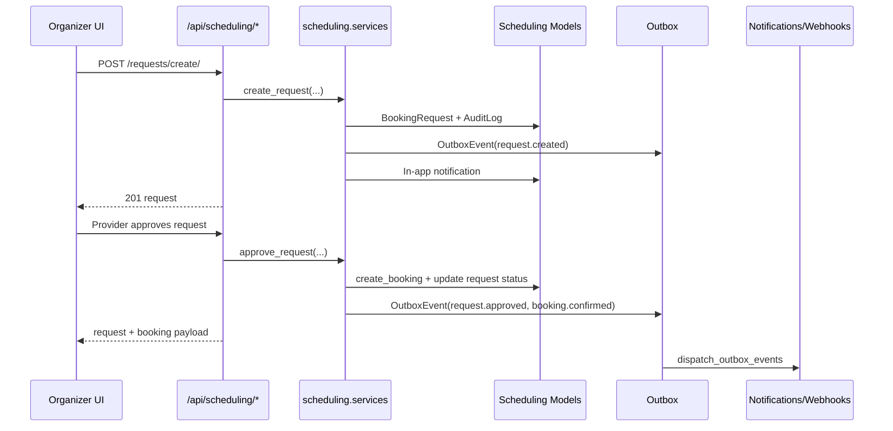

# API Design Review (Current State)

## Scope
This review is based on the current code in:
- `backend/main/main/urls.py`
- `backend/main/*/api_urls.py`, `backend/main/*/urls.py`
- `backend/main/*/views.py`, `services.py`, serializers/models where relevant
- `frontend/src/*` API consumers (direct `fetch`, `useAxios`, `schedulingApi`)

## Executive Summary
The API design is **mixed maturity**:

1. The **scheduling domain is carefully planned** and engineered with strong patterns: domain separation, service layer orchestration, idempotency, audit logs, outbox, DLQ, webhook/circuit-breaker controls, and deep tests.
2. The **platform-wide API surface is not fully unified**. There are parallel booking systems (`chat` and `scheduling`), inconsistent route/parameter conventions, duplicate route exposure, and uneven test coverage across apps.

Verdict: **partially carefully planned**.  
The newer scheduling architecture is deliberate and efficient. The overall API ecosystem still reflects iterative growth and needs consolidation for long-term efficiency.

## Functional Requirements to API Design

| Functional requirement | Current API design |
|---|---|
| Authentication and identity | `/api/accounts/login/`, `/api/accounts/register/`, `/api/accounts/me/`, `/api/accounts/token/refresh/` |
| Event drafting and publishing | `/api/events/event-drafts/`, `/api/events/event-drafts/{id}/publish/`, `/api/events/my-events/`, `/api/events/events/` |
| Marketplace discovery | `/api/search/`, `/api/artists/*`, `/api/vendors/*`, `/api/locations/*` |
| Booking negotiation and confirmation | Legacy: `/api/chat/bookings/*` + bids; New: `/api/scheduling/requests/*`, `/api/scheduling/bookings/*` |
| Availability and calendar planning | `/api/scheduling/availability/search/`, `/api/scheduling/availability/search/enriched/`, `/api/scheduling/calendar/`, rules/exceptions/slots endpoints |
| Real-time collaboration | WebSocket chat at `/ws/chat/rooms/{room_id}/`, REST chat room/message APIs |
| User notifications | `/api/notifications/*` + WebSocket `/ws/notifications/` |
| Operational reliability tooling | `/api/scheduling/ops/*`, webhook targets, outbox/dead-letter replay, management commands |

## Architecture Thinking (What Was Intentional)

1. **Domain partitioning by Django app**
   - Separate API modules for users, events, vendors, artists, locations, chat, scheduling, notifications.
2. **Workflow separation in scheduling**
   - `BookingRequest` and `Booking` are separated, which supports request-review-counter-confirm flows cleanly.
3. **Reliability by design in scheduling**
   - Idempotency records, transactional state transitions, outbox pattern, DLQ replay, audit logs, webhook signing.
4. **Role and ownership based access**
   - Scheduling permissions enforce organizer ownership of events and provider ownership of resources.
5. **Hybrid realtime model**
   - REST is the source of truth; WebSockets provide fan-out for chat and notifications.

## Mermaid: Functional Requirements to API Modules

```mermaid
graph TD
  FR1[User Auth and Identity] --> ACC[/api/accounts/*]
  FR2[Event Authoring and Publish] --> EVT[/api/events/event-drafts/* and /api/events/events/*]
  FR3[Marketplace Discovery] --> SRCH[/api/search/]
  FR3 --> ART[/api/artists/*]
  FR3 --> VEN[/api/vendors/*]
  FR3 --> LOC[/api/locations/*]
  FR4[Booking and Negotiation] --> SCH[/api/scheduling/*]
  FR4 --> CHATBOOK[/api/chat/bookings/*]
  FR5[Realtime Messaging] --> CHAT[/api/chat/rooms/*]
  FR5 --> WSCHAT[/ws/chat/rooms/{id}/]
  FR6[Notifications] --> NOTI[/api/notifications/*]
  FR6 --> WSNOTI[/ws/notifications/]
  FR7[Ops and Reliability] --> OPS[/api/scheduling/ops/*]
  FR7 --> CMD[management commands]
```

## Mermaid: Scheduling Request to Booking Flow



## Was It Carefully Planned for Current Features?

## What is planned well
1. Scheduling internals are high quality and production-leaning.
2. Event draft workflow supports multi-step persistence and publishing handoff.
3. Realtime architecture correctly treats REST persistence as source of truth.
4. Reliability and operability are first-class inside scheduling.

## Where planning is fragmented
1. **Two booking systems coexist** (`chat.Booking` and `scheduling.Booking/BookingRequest`), causing duplication in models, endpoints, and UI fallbacks.
2. **Route consistency is uneven**:
   - Example mismatch: frontend uses `/api/events/my/` while backend exposes `/api/events/my-events/`.
   - Example mismatch: frontend calendar calls `start_date/end_date` while scheduling calendar expects `start_at/end_at`.
   - Example mismatch: frontend decline calls send `message`; API serializer expects `provider_message`.
3. **Namespace duplication exists**:
   - `api/locations` includes both `locations.api_urls` and `locations.urls`.
   - `vendors/api_urls.py` includes `router.urls` twice.
   - Token refresh is exposed in multiple places (`/api/token/refresh/` and `/api/accounts/token/refresh/`).
4. **Testing is heavily imbalanced**:
   - `scheduling/tests.py` is extensive.
   - Most other API apps have minimal or placeholder tests.
5. **Client integration is not standardized**:
   - Large mix of raw `fetch`, `useAxios`, and custom API wrappers creates contract drift risk.

## Efficiency Assessment
For current shipped features, efficiency is:
- **High in scheduling-specific workflows** (negotiation, policy checks, conflict handling, ops).
- **Medium overall** due to duplicated booking APIs, inconsistent contracts, and integration drift between frontend and backend.

## Recommended Next Consolidation Steps
1. Define one canonical booking API (likely scheduling) and deprecate overlapping chat-booking paths with migration adapters.
2. Publish a versioned API contract (OpenAPI) and enforce request/response schema checks in CI.
3. Standardize naming conventions (`start_at/end_at`, `provider_message`, route aliases).
4. Centralize frontend API access through typed clients instead of ad-hoc `fetch` calls.
5. Tighten default API security posture (avoid broad `AllowAny` defaults; require explicit permissions per endpoint).
6. Raise test depth in non-scheduling domains to match production-critical behavior.
