# How does Attica actually work, at the level of its running parts?

This pile answers what runs when Attica runs and which part talks to which. The current answer is ten
parts on one machine: a React app in the browser, the Vite dev server, one Django backend under
Daphne, [Redis](../../../../../Obsidian/Software/Redis.md#where-to-learn-this)[1](../../../../../Obsidian/Mathematics/references/textbooks/system-design/system-design-interview.pdf#page=62 "System design interview, chapter 4, Design a rate limiter, High-level architecture, Works Redis as the counter store with its two commands: INCR adds one to ..."), [2](../../../../../Obsidian/Mathematics/references/textbooks/system-design/system-design-big-archive.pdf#page=318 "System design big archive, The life of a Redis query, Why an in-memory store can lose data on a restart, and Redis's two ways to persist it: the append-only ..."), [3](../../../../../Obsidian/Mathematics/references/textbooks/system-design/system-design-big-archive.pdf#page=97 "System design big archive, Redis vs Memcached, What Redis's data structures are good for: a hash to count clicks, a sorted set to rank and dedupe users, a bi..."), [▶1](https://www.youtube.com/watch?v=ZkwKyUZWkp4&t=0s "Hussein Nasser, Spin up Redis on Docker and learn basic commands, 0:00 to 9:47, Redis started in a Docker container and driven with its basic commands. Whole..."), [▶2](https://www.youtube.com/watch?v=z_NbVtbgBJw&t=0s "ByteByteGo, What Is Redis Really About? Why Is It So Popular?, Introduction to Redis, 0:00 to 2:36, What Redis is, before the chapters on persistence, scalin..."), [◆](../../../../../goal-setting/learning/system-design/foundations/plans/17-redis-cache-aside-and-the-stale-price.md "Redis cache-aside, and the stale price, system-design/foundations, plan 17. Redis in Docker Compose holding a product price for 60 seconds, read with 'redis-..."), SQLite, a media folder on disk, the [outbox](../../../../../Obsidian/Information%20Technology/System%20Design/Messaging/Outbox%20Pattern.md#where-to-learn-this)[▶1](https://www.youtube.com/watch?v=5YLpjPmsPCA&t=23s "Confluent, What is the Transactional Outbox Pattern? ∣ Designing Event-Driven Microservices, What is the dual-write problem?, 0:23 to 0:51, The problem the p..."), [▶2](https://www.youtube.com/watch?v=5YLpjPmsPCA&t=51s "Confluent, What is the Transactional Outbox Pattern?, What is the transactional outbox pattern?, 0:51 to 1:33, The pattern itself, before how its events reac..."), [◆](../../../../../goal-setting/learning/system-design/foundations/plans/19-outbox-queue-and-worker.md "The outbox, the queue and the worker, system-design/foundations, plan 19. The corner shop's order and an 'order placed' event written in one transaction, a r...") worker, and three outside services, two of
which only receive traffic when a setting turns them on.

## What is in here

One high-level design diagram (the current version and each dated version), and the spec file it is
drawn from.

## The high-level design

### attica-high-level-design-explainer

**What it shows**

Ten boxes, read left to right from the browser to the data. The colour and the small word on top of
each box say what kind of part it is (client, dev [proxy](../../../../../Obsidian/Information%20Technology/System%20Design/Scaling/Reverse%20Proxy.md#where-to-learn-this)[1](../../../../../Obsidian/Mathematics/references/textbooks/system-design/system-design-big-archive.pdf#page=397 "System design big archive, Forward proxy versus reverse proxy, The two side by side: a forward proxy acts for users (protecting them, blocking sites, caching..."), [2](../../../../../Obsidian/Mathematics/references/textbooks/system-design/grokking-the-system-design-interview.pdf#page=18 "Grokking the system design interview, section 15, Proxy server, Open, anonymous and transparent proxies, then the reverse proxy that fetches from servers and..."), [3](../../../../../Obsidian/Mathematics/references/textbooks/system-design/system-design-big-archive.pdf#page=312 "System design big archive, Load balancers vs API gateways vs reverse proxy, How a reverse proxy overlaps with a load balancer and an API gateway, and how the..."), [▶1](https://www.youtube.com/watch?v=B2G49HZxnRE&t=300s "Hussein Nasser, The Anatomy of a Proxy Server, Connection Establishment with an HTTP Proxy, 5:00 to 15:22, Traces one connection through an HTTP proxy, after..."), [▶2](https://www.youtube.com/watch?v=4NB0NDtOwIQ&t=132s "ByteByteGo, Proxy vs Reverse Proxy (Real-world Examples), Reverse Proxy, 2:12 to 4:15, The reverse proxy after the forward and transparent proxy chapters. Ch..."), [◆](../../../../../goal-setting/learning/system-design/devops-and-deployment/plans/13-dev-under-compose-with-nginx.md "Dev under Compose, with Nginx in front, system-design/devops-and-deployment, plan 13. Nginx serves '/static/' itself and forwards '/api/' to the app containe..."), backend, data store, [cache](../../../../../Obsidian/Information%20Technology/System%20Design/Caching/Cache.md#where-to-learn-this)[1](../../../../../Obsidian/Mathematics/references/textbooks/system-design/computer-networking-a-top-down-approach.pdf#page=140 "Computer networking: a top-down approach, section 2.2.5, Web caching, A web cache, or proxy server, in front of an institution's 15 Mbps access link worked w..."), [2](../../../../../Obsidian/Mathematics/references/textbooks/system-design/system-design-interview.pdf#page=15 "System design interview, chapter 1, Cache, Walks one web request through a cache tier (check the cache, on a miss query the database and store the answer), t..."), [3](../../../../../Obsidian/Mathematics/references/textbooks/system-design/grokking-the-system-design-interview.pdf#page=15 "Grokking the system design interview, section 13, Caching, The three invalidation schemes (write-through, write-around and write-back), each with what it cos..."), [▶1](https://www.youtube.com/watch?v=dGAgxozNWFE&t=239s "ByteByteGo, Cache Systems Every Developer Should Know, Distributed and backend cache, 3:59 to 4:42, The shared cache that sits between services and the datab..."), [▶2](https://www.youtube.com/watch?v=RCdAGvtTYI0&t=97s "Hayk Simonyan, The Ultimate Guide to Caching and CDNs, Cache HIT, MISS, and Ratio, 1:37 to 2:09, Names a hit, a miss and the hit ratio that measures a cache...."), [◆](../../../../../goal-setting/learning/system-design/foundations/plans/10-the-nginx-cache.md "The nginx cache: MISS, then HIT, system-design/foundations, plan 10. An nginx cache answers the corner shop's catalogue page by itself on the second request,..."), worker, third
party), and a logo marks every box that is a named product. A solid arrow is a request that waits for
an answer, a dashed arrow is asynchronous, and a dotted arrow only carries traffic when a setting
enables it. The two arrows leaving the web app are the two ways it reaches the backend: through the
Vite proxy, and straight to `127.0.0.1:8000` from `useAxios`.

**How we got this image**

We read `environment/overview.md` and checked each part against the code on 2026-10-24:
`frontend/package.json`, `frontend/vite.config.js`, `backend/main/main/settings.py`, the chat and
notification consumers, `scheduling/management/commands/run_outbox_worker.py` and the [outbox](../../../../../Obsidian/Information%20Technology/System%20Design/Messaging/Outbox%20Pattern.md#where-to-learn-this)[▶1](https://www.youtube.com/watch?v=5YLpjPmsPCA&t=23s "Confluent, What is the Transactional Outbox Pattern? ∣ Designing Event-Driven Microservices, What is the dual-write problem?, 0:23 to 0:51, The problem the p..."), [▶2](https://www.youtube.com/watch?v=5YLpjPmsPCA&t=51s "Confluent, What is the Transactional Outbox Pattern?, What is the transactional outbox pattern?, 0:51 to 1:33, The pattern itself, before how its events reac..."), [◆](../../../../../goal-setting/learning/system-design/foundations/plans/19-outbox-queue-and-worker.md "The outbox, the queue and the worker, system-design/foundations, plan 19. The corner shop's order and an 'order placed' event written in one transaction, a r...") dispatch
in `scheduling/services.py`. The parts and arrows were written into
`attica-high-level-design-explainer.json` and drawn by the `hld-diagram` skill's
`draw_hld.py`, which inlines the product logos from Simple Icons 13.21.0. The same picture is
published as a private page at https://claude.ai/artifact/GLg4UBzHQCdY4U9kteM4po, whose closed
disclosure lists the file and line behind every box.

**What it lets you say**

Attica runs as four hand-started processes ([Redis](../../../../../Obsidian/Software/Redis.md#where-to-learn-this)[1](../../../../../Obsidian/Mathematics/references/textbooks/system-design/system-design-interview.pdf#page=62 "System design interview, chapter 4, Design a rate limiter, High-level architecture, Works Redis as the counter store with its two commands: INCR adds one to ..."), [2](../../../../../Obsidian/Mathematics/references/textbooks/system-design/system-design-big-archive.pdf#page=318 "System design big archive, The life of a Redis query, Why an in-memory store can lose data on a restart, and Redis's two ways to persist it: the append-only ..."), [3](../../../../../Obsidian/Mathematics/references/textbooks/system-design/system-design-big-archive.pdf#page=97 "System design big archive, Redis vs Memcached, What Redis's data structures are good for: a hash to count clicks, a sorted set to rank and dedupe users, a bi..."), [▶1](https://www.youtube.com/watch?v=ZkwKyUZWkp4&t=0s "Hussein Nasser, Spin up Redis on Docker and learn basic commands, 0:00 to 9:47, Redis started in a Docker container and driven with its basic commands. Whole..."), [▶2](https://www.youtube.com/watch?v=z_NbVtbgBJw&t=0s "ByteByteGo, What Is Redis Really About? Why Is It So Popular?, Introduction to Redis, 0:00 to 2:36, What Redis is, before the chapters on persistence, scalin..."), [◆](../../../../../goal-setting/learning/system-design/foundations/plans/17-redis-cache-aside-and-the-stale-price.md "Redis cache-aside, and the stale price, system-design/foundations, plan 17. Redis in Docker Compose holding a product price for 60 seconds, read with 'redis-..."), the Daphne backend, the Vite dev server, the
outbox worker) around one SQLite file, with Redis carrying both the [websocket](../../../../../Obsidian/Information%20Technology/Networking/WebSocket.md#where-to-learn-this)[1](../../../../../Obsidian/Mathematics/references/textbooks/system-design/system-design-interview.pdf#page=182 "System design interview, chapter 12, Design a chat system, WebSocket, The connection the client opens as HTTP and upgrades through a handshake, bi-directiona..."), [2](../../../../../Obsidian/Mathematics/references/textbooks/system-design/system-design-interview.pdf#page=190 "System design interview, chapter 12, Design a chat system, Service discovery and 1 on 1 chat flow, Works one message end to end: user A connects to chat serv..."), [3](../../../../../Obsidian/Mathematics/references/textbooks/system-design/system-design-big-archive.pdf#page=425 "System design big archive, Can a web server provide real-time updates?, WebSocket against server-sent events: both let the server send the latest data once c..."), [▶1](https://www.youtube.com/watch?v=2Nt-ZrNP22A&t=870s "Hussein Nasser, WebSockets Crash Course, WebSockets Example Code, 14:30 to 36:40, A WebSocket server and client written on screen. Chapter-timed."), [▶2](https://www.youtube.com/watch?v=2Nt-ZrNP22A&t=480s "Hussein Nasser, WebSockets Crash Course, WebSockets Handshake, 8:00 to 11:20, The upgrade handshake that turns an HTTP request into a WebSocket. Chapter-timed."), [◆](../../../../../goal-setting/learning/projects/attica/event-creation/plans/02-rebuild-from-scratch/plans/23-channels-websocket-push.md "Channels websocket push, projects/attica/event-creation/plans/02-rebuild-from-scratch, plan 23. A Channels consumer over the Redis channel layer, the '/ws' p...") channel layer (db 0)
and the page cache (db 1).

**What it cannot say**

It shows the local development stack only; nothing here is deployed. The [REST API](../../../../../Obsidian/Information%20Technology/System%20Design/APIs/REST%20API.md#where-to-learn-this)[1](../../../../../Obsidian/Mathematics/references/textbooks/system-design/system-design-interview.pdf#page=121 "System design interview, chapter 8, Design a URL shortener, Works two REST-style endpoints for one service, 'POST api/v1/data/shorten' taking the long URL an..."), [2](../../../../../Obsidian/Mathematics/references/textbooks/system-design/system-design-big-archive.pdf#page=411 "System design big archive, What is a REST API?, The six constraints an API must follow to be RESTful: client-server, stateless, uniform interface, cacheable,..."), [3](../../../../../Obsidian/Mathematics/references/textbooks/system-design/system-design-big-archive.pdf#page=234 "System design big archive, REST API Vs. GraphQL, REST's HTTP methods for CRUD and its easy caching, against the several round trips it may need to assemble r..."), [▶1](https://www.youtube.com/watch?v=M3XQ6yEC51Q&t=1098s "Hussein Nasser, REST API Pros and Cons (Explained by Example), REST API github api, 18:18 to 25:45, A real REST API worked through, after the chapters on rep..."), [▶2](https://www.youtube.com/watch?v=-mN3VyJuCjM&t=47s "ByteByteGo, What Is REST API? Examples And How To Use It: Crash Course System Design #3, REST API Basics, 0:47 to 2:05, The basics, followed by a chapter on ..."), [◆](../../../../../goal-setting/learning/ai-engineering/product-data-validation-end-to-end/plans/19-curl-against-rest-mock.md "curl against a REST mock, ai-engineering/product-data-validation-end-to-end, plan 19. 'curl' against two running mocks, reading the status line, headers and ..."), the WebSocket
consumers and the Django admin share the one backend box, so it cannot show which of them a request
reaches. It does not show that the booking-request path writes its notification row without pushing
it to the channel layer; that gap is in `environment/overview.md` under known gaps. [Webhook](../../../../../Obsidian/Information%20Technology/System%20Design/Messaging/Webhook.md#where-to-learn-this)[▶1](https://www.youtube.com/watch?v=-4Lid7tBr6Y&t=320s "Hussein Nasser, Webhooks Tutorial with Discord and Vanilla Javascript (fetch api), Example, 5:20 to 15:06, Sends messages to a Discord channel through its we..."), [▶2](https://www.youtube.com/watch?v=x_jjhcDrISk&t=90s "ByteByteGo, Top 3 Things You Should Know About Webhooks!, How webhooks work, 1:30 to 2:00, The mechanism, straight after the chapter on polling and long poll..."), [◆](../../../../../goal-setting/learning/system-design/foundations/plans/20-providers-webhook-and-one-key.md "The providers, the webhook, and one key, system-design/foundations, plan 20. The fake payment provider calls back to the corner shop's payment service by web...") targets are
drawn because the delivery code exists, but `SCHEDULING_WEBHOOK_TARGETS` is empty by default. Stripe
has no box because the code only mentions it in comments.

**Where it came from and what judged it**

Built from the repository at commit a85cc0c plus its uncommitted working tree. No review file judged
it.

**Held since 2026-10-24.** Draws the system `environment/overview.md` describes in words; kept until a
one-line link to it lands in that file's index under "Pictures", which this filing was not allowed to
write.

### Versions

Each time a part is added or removed, the diagram is redrawn from the spec file and the new picture
is kept here with its date, so the build's growth stays visible.

**2026-10-24: first version**

Ten boxes and ten arrows, drawn from the repository as it stood that day.
