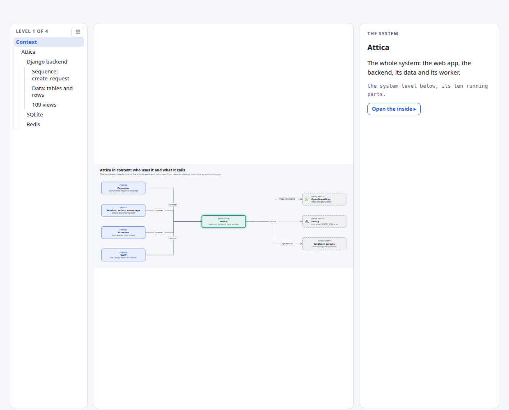

# Stills of attica-high-level-design-explainer

One screenshot per anchor of the scene page, in light and dark: 35 anchors, 70 stills. They are taken by `~/.claude/skills/hld-diagram/scripts/shoot_anchors.py` from the built page, headless, so a runbook step or a plan can show the level it means beside its text and link to the same anchor of the live page.

## How they are sorted

`attica-high-level-design-explainer__<anchor>-<theme>.png`. The anchor is the place on the page (`system` is the top level, `<box>` a box's panel, `<box>-inside` the level inside it); the theme is light or dark. Every still is retaken on every build, so it shows the page as it was built, never an older version.

## Every anchor

| Anchor | What it shows | Light | Dark |
|---|---|---|---|
| [#context](https://claude.ai/artifact/GLg4UBzHQCdY4U9kteM4po#context) | Attica in context: who uses it and what it calls (the system level) | [light](attica-high-level-design-explainer__context-light.png) | [dark](attica-high-level-design-explainer__context-dark.png) |
| [#attica](https://claude.ai/artifact/GLg4UBzHQCdY4U9kteM4po#attica) | Attica (the system level) | [light](attica-high-level-design-explainer__attica-light.png) | [dark](attica-high-level-design-explainer__attica-dark.png) |
| [#system](https://claude.ai/artifact/GLg4UBzHQCdY4U9kteM4po#system) | Get the code and its packages (Context ▸ Attica) | [light](attica-high-level-design-explainer__system-light.png) | [dark](attica-high-level-design-explainer__system-dark.png) |
| [#backend](https://claude.ai/artifact/GLg4UBzHQCdY4U9kteM4po#backend) | Django backend (Context ▸ Attica) | [light](attica-high-level-design-explainer__backend-light.png) | [dark](attica-high-level-design-explainer__backend-dark.png) |
| [#sqlite](https://claude.ai/artifact/GLg4UBzHQCdY4U9kteM4po#sqlite) | SQLite (Context ▸ Attica) | [light](attica-high-level-design-explainer__sqlite-light.png) | [dark](attica-high-level-design-explainer__sqlite-dark.png) |
| [#redis](https://claude.ai/artifact/GLg4UBzHQCdY4U9kteM4po#redis) | Redis (Context ▸ Attica) | [light](attica-high-level-design-explainer__redis-light.png) | [dark](attica-high-level-design-explainer__redis-dark.png) |
| [#backend-inside](https://claude.ai/artifact/GLg4UBzHQCdY4U9kteM4po#backend-inside) | Inside the Django backend: model, view, template (Context ▸ Attica ▸ Django backend) | [light](attica-high-level-design-explainer__backend-inside-light.png) | [dark](attica-high-level-design-explainer__backend-inside-dark.png) |
| [#services](https://claude.ai/artifact/GLg4UBzHQCdY4U9kteM4po#services) | Booking services (Context ▸ Attica ▸ Django backend) | [light](attica-high-level-design-explainer__services-light.png) | [dark](attica-high-level-design-explainer__services-dark.png) |
| [#dj-views](https://claude.ai/artifact/GLg4UBzHQCdY4U9kteM4po#dj-views) | 109 views (Context ▸ Attica ▸ Django backend) | [light](attica-high-level-design-explainer__dj-views-light.png) | [dark](attica-high-level-design-explainer__dj-views-dark.png) |
| [#services-inside](https://claude.ai/artifact/GLg4UBzHQCdY4U9kteM4po#services-inside) | create_request, step by step (Context ▸ Attica ▸ Django backend ▸ Booking services · Sequence: create_request Data: tables and rows) | [light](attica-high-level-design-explainer__services-inside-light.png) | [dark](attica-high-level-design-explainer__services-inside-dark.png) |
| [#services-data](https://claude.ai/artifact/GLg4UBzHQCdY4U9kteM4po#services-data) | The tables create_request reads and writes (Context ▸ Attica ▸ Django backend ▸ Booking services · Sequence: create_request Data: tables and rows) | [light](attica-high-level-design-explainer__services-data-light.png) | [dark](attica-high-level-design-explainer__services-data-dark.png) |
| [#sqlite-inside](https://claude.ai/artifact/GLg4UBzHQCdY4U9kteM4po#sqlite-inside) | Inside SQLite (Context ▸ Attica ▸ SQLite) | [light](attica-high-level-design-explainer__sqlite-inside-light.png) | [dark](attica-high-level-design-explainer__sqlite-inside-dark.png) |
| [#redis-inside](https://claude.ai/artifact/GLg4UBzHQCdY4U9kteM4po#redis-inside) | Inside Redis: its databases and keys (Context ▸ Attica ▸ Redis) | [light](attica-high-level-design-explainer__redis-inside-light.png) | [dark](attica-high-level-design-explainer__redis-inside-dark.png) |
| [#views-inside](https://claude.ai/artifact/GLg4UBzHQCdY4U9kteM4po#views-inside) | What the views return: the joins behind them (Context ▸ Attica ▸ Django backend ▸ 109 views) | [light](attica-high-level-design-explainer__views-inside-light.png) | [dark](attica-high-level-design-explainer__views-inside-dark.png) |
| [#sqlite-vendors](https://claude.ai/artifact/GLg4UBzHQCdY4U9kteM4po#sqlite-vendors) | vendors: 18 tables (Context ▸ Attica ▸ SQLite ▸ vendors) | [light](attica-high-level-design-explainer__sqlite-vendors-light.png) | [dark](attica-high-level-design-explainer__sqlite-vendors-dark.png) |
| [#sqlite-scheduling](https://claude.ai/artifact/GLg4UBzHQCdY4U9kteM4po#sqlite-scheduling) | scheduling: 16 tables (Context ▸ Attica ▸ SQLite ▸ scheduling) | [light](attica-high-level-design-explainer__sqlite-scheduling-light.png) | [dark](attica-high-level-design-explainer__sqlite-scheduling-dark.png) |
| [#sqlite-locations](https://claude.ai/artifact/GLg4UBzHQCdY4U9kteM4po#sqlite-locations) | locations: 12 tables (Context ▸ Attica ▸ SQLite ▸ locations) | [light](attica-high-level-design-explainer__sqlite-locations-light.png) | [dark](attica-high-level-design-explainer__sqlite-locations-dark.png) |
| [#sqlite-users](https://claude.ai/artifact/GLg4UBzHQCdY4U9kteM4po#sqlite-users) | users: 9 tables (Context ▸ Attica ▸ SQLite ▸ users) | [light](attica-high-level-design-explainer__sqlite-users-light.png) | [dark](attica-high-level-design-explainer__sqlite-users-dark.png) |
| [#sqlite-chat](https://claude.ai/artifact/GLg4UBzHQCdY4U9kteM4po#sqlite-chat) | chat: 7 tables (Context ▸ Attica ▸ SQLite ▸ chat) | [light](attica-high-level-design-explainer__sqlite-chat-light.png) | [dark](attica-high-level-design-explainer__sqlite-chat-dark.png) |
| [#sqlite-artists](https://claude.ai/artifact/GLg4UBzHQCdY4U9kteM4po#sqlite-artists) | artists: 5 tables (Context ▸ Attica ▸ SQLite ▸ artists) | [light](attica-high-level-design-explainer__sqlite-artists-light.png) | [dark](attica-high-level-design-explainer__sqlite-artists-dark.png) |
| [#sqlite-events](https://claude.ai/artifact/GLg4UBzHQCdY4U9kteM4po#sqlite-events) | events: 4 tables (Context ▸ Attica ▸ SQLite ▸ events) | [light](attica-high-level-design-explainer__sqlite-events-light.png) | [dark](attica-high-level-design-explainer__sqlite-events-dark.png) |
| [#sqlite-cart](https://claude.ai/artifact/GLg4UBzHQCdY4U9kteM4po#sqlite-cart) | cart: 1 table (Context ▸ Attica ▸ SQLite ▸ cart) | [light](attica-high-level-design-explainer__sqlite-cart-light.png) | [dark](attica-high-level-design-explainer__sqlite-cart-dark.png) |
| [#sqlite-notifications](https://claude.ai/artifact/GLg4UBzHQCdY4U9kteM4po#sqlite-notifications) | notifications: 1 table (Context ▸ Attica ▸ SQLite ▸ notifications) | [light](attica-high-level-design-explainer__sqlite-notifications-light.png) | [dark](attica-high-level-design-explainer__sqlite-notifications-dark.png) |
| [#sqlite-tickets](https://claude.ai/artifact/GLg4UBzHQCdY4U9kteM4po#sqlite-tickets) | tickets: 1 table (Context ▸ Attica ▸ SQLite ▸ tickets) | [light](attica-high-level-design-explainer__sqlite-tickets-light.png) | [dark](attica-high-level-design-explainer__sqlite-tickets-dark.png) |
| [#sqlite-django](https://claude.ai/artifact/GLg4UBzHQCdY4U9kteM4po#sqlite-django) | django: 4 tables (Context ▸ Attica ▸ SQLite ▸ django) | [light](attica-high-level-design-explainer__sqlite-django-light.png) | [dark](attica-high-level-design-explainer__sqlite-django-dark.png) |
| [#sqlite-auth](https://claude.ai/artifact/GLg4UBzHQCdY4U9kteM4po#sqlite-auth) | auth: 3 tables (Context ▸ Attica ▸ SQLite ▸ auth) | [light](attica-high-level-design-explainer__sqlite-auth-light.png) | [dark](attica-high-level-design-explainer__sqlite-auth-dark.png) |
| [#osm-learn](https://claude.ai/artifact/GLg4UBzHQCdY4U9kteM4po#osm-learn) | OpenStreetMap (Context ▸ Attica) | [light](attica-high-level-design-explainer__osm-learn-light.png) | [dark](attica-high-level-design-explainer__osm-learn-dark.png) |
| [#vite-learn](https://claude.ai/artifact/GLg4UBzHQCdY4U9kteM4po#vite-learn) | Vite dev server (Context ▸ Attica) | [light](attica-high-level-design-explainer__vite-learn-light.png) | [dark](attica-high-level-design-explainer__vite-learn-dark.png) |
| [#sentry-learn](https://claude.ai/artifact/GLg4UBzHQCdY4U9kteM4po#sentry-learn) | Sentry (Context ▸ Attica) | [light](attica-high-level-design-explainer__sentry-learn-light.png) | [dark](attica-high-level-design-explainer__sentry-learn-dark.png) |
| [#backend-learn](https://claude.ai/artifact/GLg4UBzHQCdY4U9kteM4po#backend-learn) | Django backend (Context ▸ Attica) | [light](attica-high-level-design-explainer__backend-learn-light.png) | [dark](attica-high-level-design-explainer__backend-learn-dark.png) |
| [#media-learn](https://claude.ai/artifact/GLg4UBzHQCdY4U9kteM4po#media-learn) | Uploaded media (Context ▸ Attica) | [light](attica-high-level-design-explainer__media-learn-light.png) | [dark](attica-high-level-design-explainer__media-learn-dark.png) |
| [#redis-learn](https://claude.ai/artifact/GLg4UBzHQCdY4U9kteM4po#redis-learn) | Redis (Context ▸ Attica) | [light](attica-high-level-design-explainer__redis-learn-light.png) | [dark](attica-high-level-design-explainer__redis-learn-dark.png) |
| [#sqlite-learn](https://claude.ai/artifact/GLg4UBzHQCdY4U9kteM4po#sqlite-learn) | SQLite (Context ▸ Attica) | [light](attica-high-level-design-explainer__sqlite-learn-light.png) | [dark](attica-high-level-design-explainer__sqlite-learn-dark.png) |
| [#worker-learn](https://claude.ai/artifact/GLg4UBzHQCdY4U9kteM4po#worker-learn) | Outbox worker (Context ▸ Attica) | [light](attica-high-level-design-explainer__worker-learn-light.png) | [dark](attica-high-level-design-explainer__worker-learn-dark.png) |
| [#hooks-learn](https://claude.ai/artifact/GLg4UBzHQCdY4U9kteM4po#hooks-learn) | Webhook targets (Context ▸ Attica) | [light](attica-high-level-design-explainer__hooks-learn-light.png) | [dark](attica-high-level-design-explainer__hooks-learn-dark.png) |

## One example

