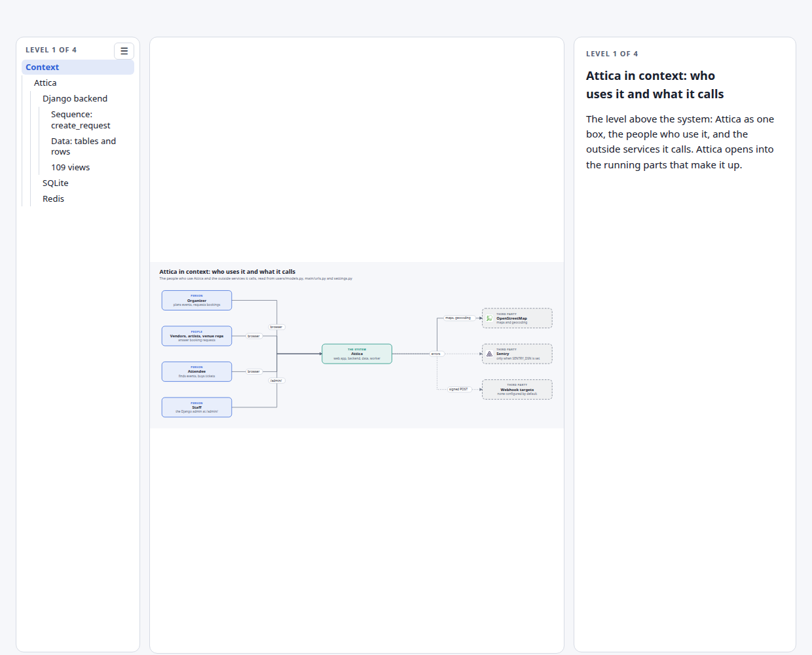
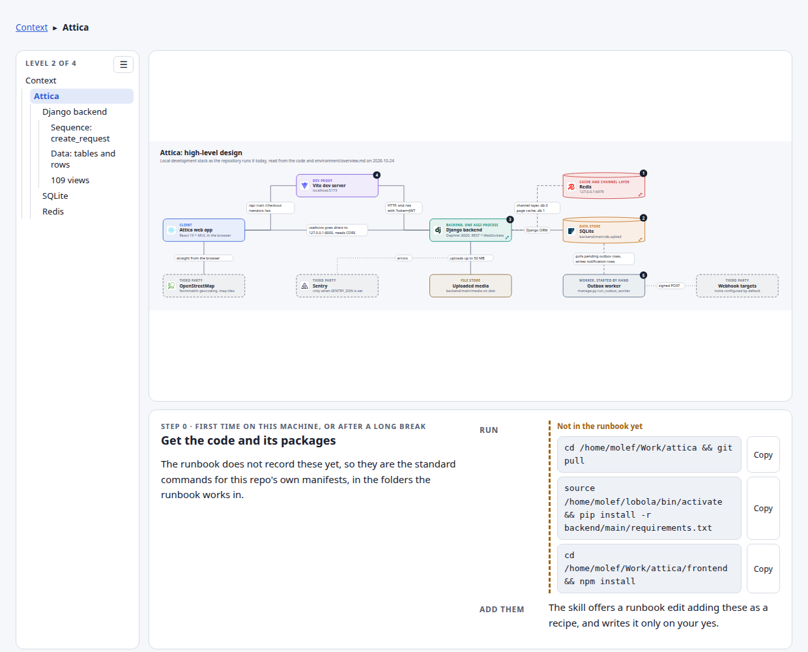
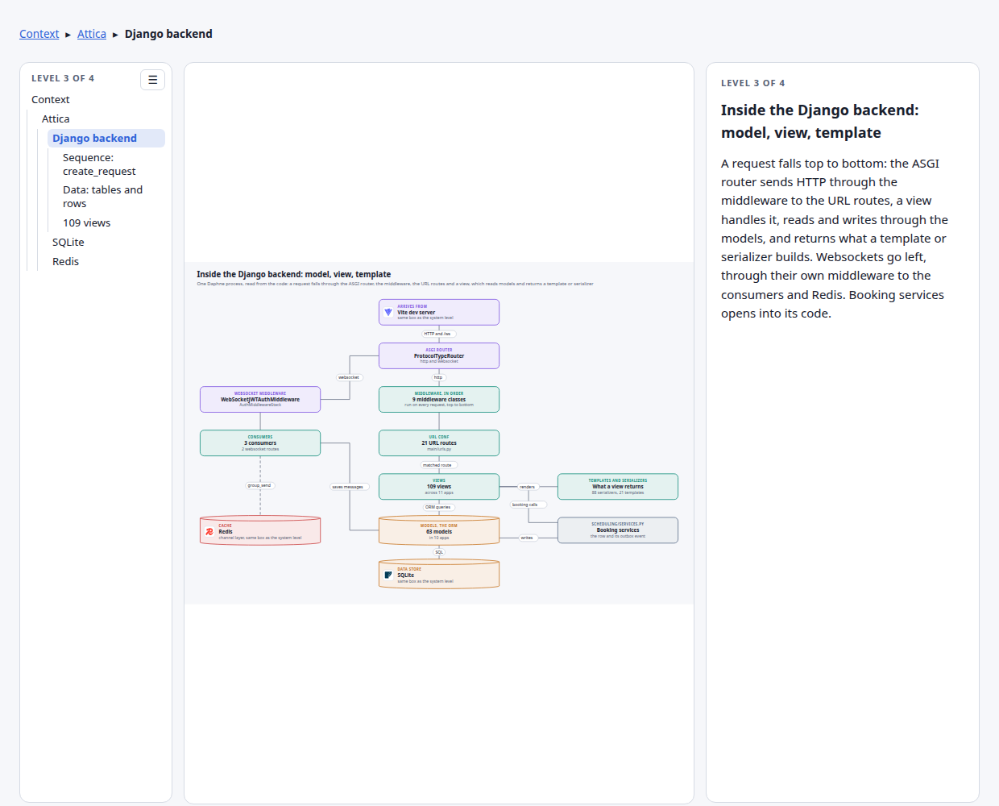
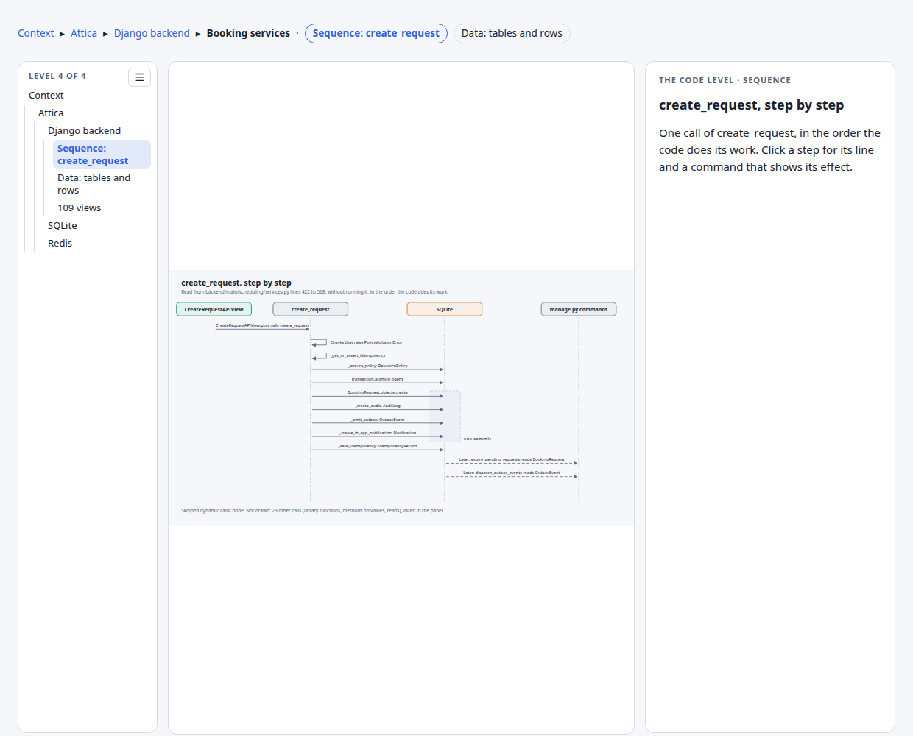
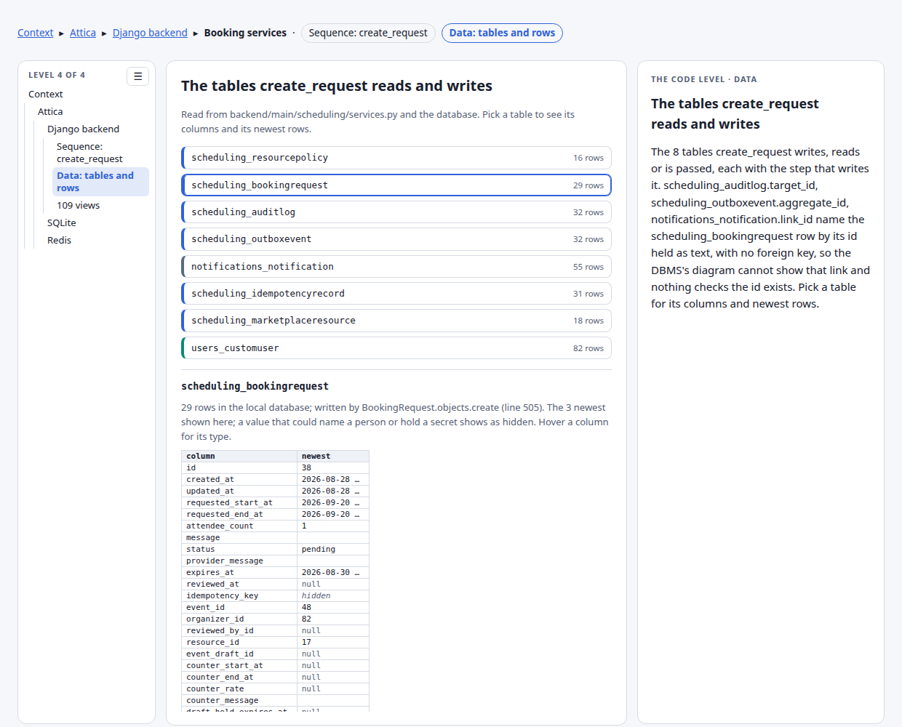
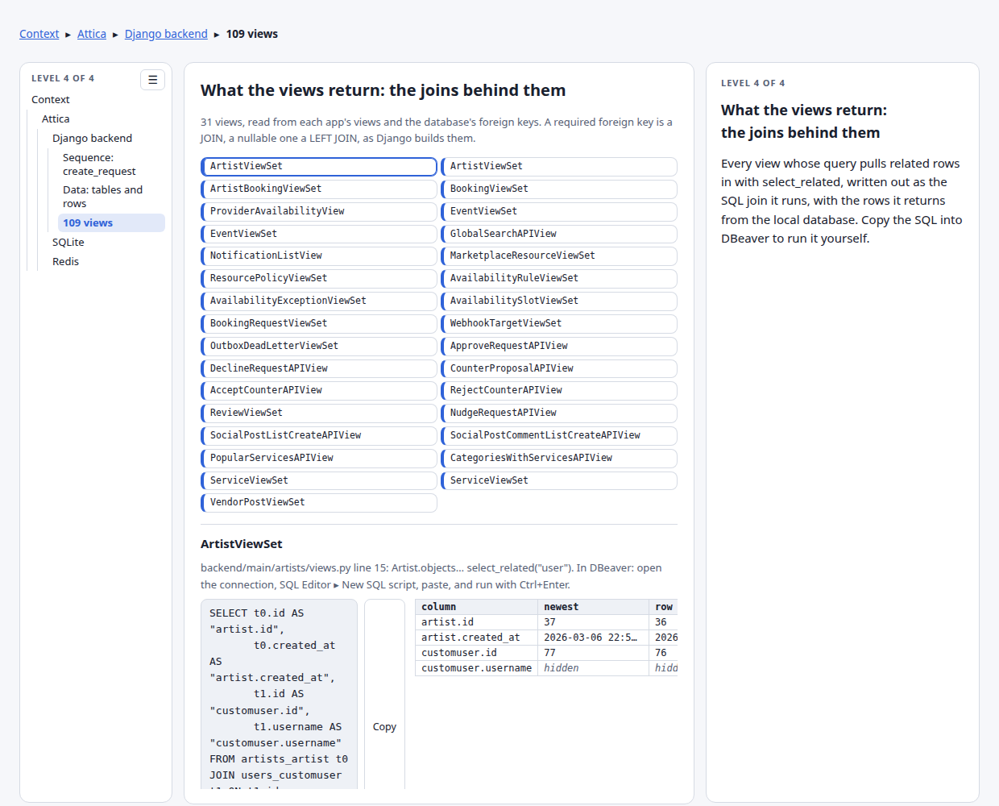
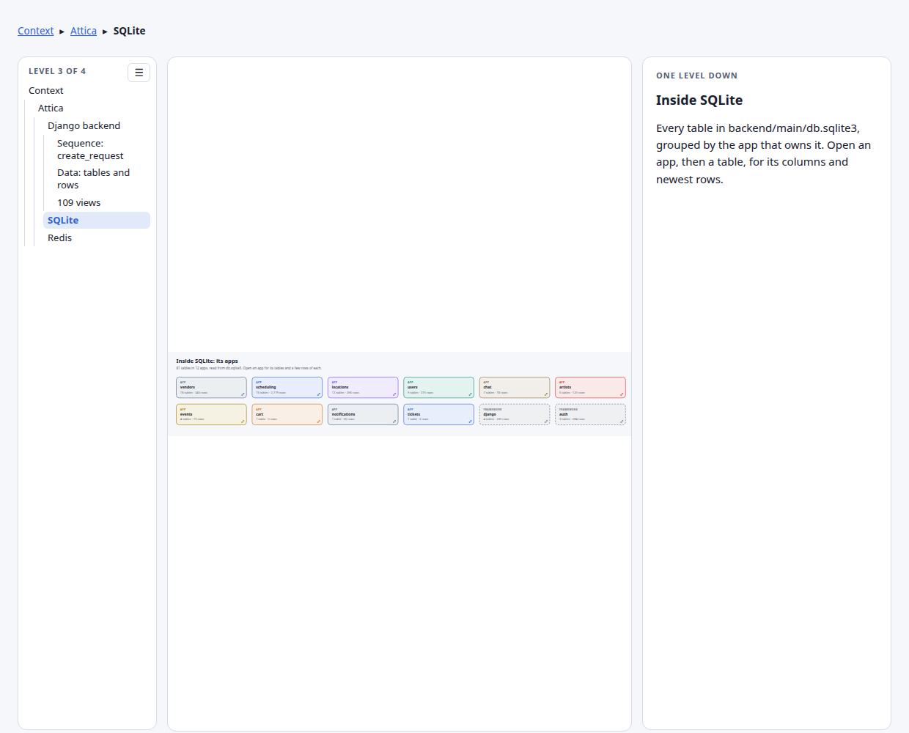
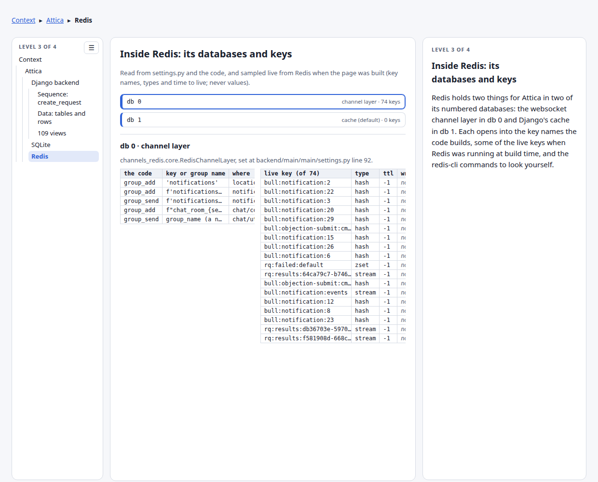

# Attica: the high-level design, explained

This is the companion to [the live scene](https://claude.ai/artifact/GLg4UBzHQCdY4U9kteM4po), the page that opens every part of the design into its inside. It walks the same 8 levels in order, from the people who use the system down to code and database rows, one section a level, with a still of each that links to the same place on the live page. The words name the parts the way the code and the runbook do, and each links to where the idea is taught.

## Level 1 of 4: Attica in context: who uses it and what it calls

The level above the system: Attica as one box, the people who use it, and the outside services it calls. Attica opens into the running parts that make it up.

**Organizer**. Plans events and asks venues, artists and vendors to book. Read from users/models.py lines 26 to 33, USER_TYPES, the default user_type.

**Vendors, artists, venue reps**. Receive booking requests and approve, decline or counter them. Read from the same USER_TYPES, the three kinds of provider a booking request is sent to.

**Attendee**. Finds events and buys tickets. Read from the same USER_TYPES.

**Staff**. Manage the data directly in the [Django](../../../../../Obsidian/Software/Django/Django.md#where-to-learn-this)[▶1](https://www.youtube.com/watch?v=GGkFg52Ot5o&t=153s "Telusko, #9 Django tutorials, Model View Template in Django, Model View Template, 2:33 to 3:10, The three parts named and placed, after a chapter on separati..."), [▶2](https://www.youtube.com/watch?v=GGkFg52Ot5o&t=303s "Telusko, the same video, MVT vs MVC, 5:03 to 5:54, Where Django's template stands in for MVC's view and its view for MVC's controller. Chapter-timed."), [◆](../../../../../goal-setting/learning/projects/attica/event-creation/plans/02-rebuild-from-scratch/plans/02-django-basics.md "Django basics, fit for purpose, projects/attica/event-creation, rebuild plan 02. Project against app, the urls-to-views-to-settings path, and runserver again...") admin. Read from main/urls.py line 33, admin.site.urls.

**Attica**. The whole system: the web app, the backend, its data and its worker. Read from the system level below, its ten running parts. It opens into [its inside](https://claude.ai/artifact/GLg4UBzHQCdY4U9kteM4po#system).

## Level 2 of 4: Attica: high-level design

**Attica web app**. The [React](../../../../../Obsidian/Software/React/React.md#where-to-learn-this)[▶1](https://www.youtube.com/watch?v=Tn6-PIqc4UM&t=0s "Fireship, React in 100 Seconds, Intro, 0:00 to 1:10, Components, JSX, state and props in one minute, the same four ideas this note's opening lists. Chapter-t..."), [◆](../../../../../goal-setting/learning/projects/attica/event-creation/plans/02-rebuild-from-scratch/plans/01-react-state-basics.md "React state basics: useReducer, context, localStorage, projects/attica/event-creation, rebuild plan 01. The three React tools Attica's wizard is built from, ...") and MUI front end people use in the browser. It has no process of its own: [Vite](../../../../../Obsidian/Software/Vite.md#where-to-learn-this)[▶1](https://www.youtube.com/watch?v=KCrXgy8qtjM&t=37s "Fireship, Vite in 100 Seconds, How Vite works, 0:37 to 1:01, Native ES modules served unbundled while developing, against the bundlers before it. Chapter-timed."), [▶2](https://www.youtube.com/watch?v=KCrXgy8qtjM&t=91s "Fireship, the same video, Local development, 1:31 to 1:55, The dev server and its hot reload. Chapter-timed."), [◆](../../../../../goal-setting/learning/projects/attica/event-creation/plans/02-rebuild-from-scratch/plans/13-vite-proxy-and-cors.md "The Vite proxy and CORS, projects/attica/event-creation, rebuild plan 13. The wizard wired to the backend three ways: broken cross-origin, fixed with CORS, m...") serves it. Read from frontend/package.json (react 19.1, @mui/material 7.1).

**[OpenStreetMap](../../../../../Obsidian/Software/OpenStreetMap.md#where-to-learn-this)[▶1](https://www.youtube.com/watch?v=nTt-l6-QQCc&t=0s "LizardTech, Getting Started with Nominatim: Geocoding & Reverse Geocoding, 0:00 to 1:12, Both directions, an address to a point and back, from OpenStreetMap ..."), [▶2](https://www.youtube.com/watch?v=29q5xkJ-YFE&t=0s "Try an API, OpenStreetMap, Geocoding data with the Nominatim OpenStreetMap API, 0:00 to 0:45, One Nominatim search request and the JSON it returns. Whole video."), [◆](../../../../../goal-setting/learning/projects/attica/event-creation/plans/01-tour-the-real-flow/plans/04-location-pricing-amenities.md "Location, Pricing, Amenities, projects/attica/event-creation, tour plan 04. Step 4's address search watched as a GET to nominatim.openstreetmap.org in DevToo...")**. Map tiles and geocoding (Nominatim), called straight from the browser. Nothing to start; it needs internet access. Read from frontend/src/ListingStep4.jsx (Nominatim) and components/MapComponent.jsx (tiles).

**Vite dev server** (step 4 to start it). Serves the React app while developing and forwards /api, /vendors, /cart, /checkout and /ws to the [Django](../../../../../Obsidian/Software/Django/Django.md#where-to-learn-this)[▶1](https://www.youtube.com/watch?v=GGkFg52Ot5o&t=153s "Telusko, #9 Django tutorials, Model View Template in Django, Model View Template, 2:33 to 3:10, The three parts named and placed, after a chapter on separati..."), [▶2](https://www.youtube.com/watch?v=GGkFg52Ot5o&t=303s "Telusko, the same video, MVT vs MVC, 5:03 to 5:54, Where Django's template stands in for MVC's view and its view for MVC's controller. Chapter-timed."), [◆](../../../../../goal-setting/learning/projects/attica/event-creation/plans/02-rebuild-from-scratch/plans/02-django-basics.md "Django basics, fit for purpose, projects/attica/event-creation, rebuild plan 02. Project against app, the urls-to-views-to-settings path, and runserver again...") backend. Read from frontend/vite.config.js lines 16 to 25, the proxy for /api, /vendors, /cart, /checkout and /ws.

**[Sentry](../../../../../Obsidian/Software/Sentry.md#where-to-learn-this)[1](../../../../../Obsidian/Mathematics/references/textbooks/system-design/system-design-big-archive.pdf#page=35 "System design big archive, 10 Essential Components of a Production Web Application, Monitoring tools such as Sentry, Grafana and Prometheus as one of the ten..."), [▶1](https://www.youtube.com/watch?v=qGghfAmxaGU&t=307s "Very Academy, Sentry Django Integration, Error Reporting, Sentry, 5:07 to 14:00, The SDK added to a Django project and an exception watched arriving as an is..."), [▶2](https://www.youtube.com/watch?v=DzhVEK65eYg&t=308s "Sentry, Sentry 101: Error Monitoring For Backend Applications, Configure SDK, 5:08 to 5:52, The SDK's setup from Sentry's own team, before data scrubbing, re...")**. Receives the backend's error reports, only when SENTRY_DSN is set. Read from settings.py lines 247 to 257, skipped when SENTRY_DSN is unset.

**Django backend** (step 3 to start it). One [Daphne](../../../../../Obsidian/Software/Python/ASGI.md#where-to-learn-this)[▶1](https://www.youtube.com/watch?v=LtpJup6vcS4&t=30s "Jerin Jose, WSGI & ASGI Simplified, WSGI ASGI, 0:30 to 2:15, The two interfaces side by side, the server on one side and the app on the other. Chapter-timed."), [▶2](https://www.youtube.com/watch?v=LtpJup6vcS4&t=210s "Jerin Jose, the same video, ASGI Workers, 3:30 to 5:22, How one ASGI worker serves many connections at once, after WSGI's one-request-per-worker. Chapter-timed."), [◆](../../../../../goal-setting/learning/projects/attica/event-creation/plans/02-rebuild-from-scratch/plans/24-daphne-under-systemd.md "Daphne under systemd, projects/attica/event-creation, rebuild plan 24. Daphne made survivable: a unit file from zero, killed with -9 and watched coming back.") process that answers the [REST API](../../../../../Obsidian/Information%20Technology/System%20Design/APIs/REST%20API.md#where-to-learn-this)[1](../../../../../Obsidian/Mathematics/references/textbooks/system-design/system-design-interview.pdf#page=121 "System design interview, chapter 8, Design a URL shortener, Works two REST-style endpoints for one service, 'POST api/v1/data/shorten' taking the long URL an..."), [2](../../../../../Obsidian/Mathematics/references/textbooks/system-design/system-design-big-archive.pdf#page=411 "System design big archive, What is a REST API?, The six constraints an API must follow to be RESTful: client-server, stateless, uniform interface, cacheable,..."), [3](../../../../../Obsidian/Mathematics/references/textbooks/system-design/system-design-big-archive.pdf#page=234 "System design big archive, REST API Vs. GraphQL, REST's HTTP methods for CRUD and its easy caching, against the several round trips it may need to assemble r..."), [▶1](https://www.youtube.com/watch?v=M3XQ6yEC51Q&t=1098s "Hussein Nasser, REST API Pros and Cons (Explained by Example), REST API github api, 18:18 to 25:45, A real REST API worked through, after the chapters on rep..."), [▶2](https://www.youtube.com/watch?v=-mN3VyJuCjM&t=47s "ByteByteGo, What Is REST API? Examples And How To Use It: Crash Course System Design #3, REST API Basics, 0:47 to 2:05, The basics, followed by a chapter on ..."), [◆](../../../../../goal-setting/learning/ai-engineering/product-data-validation-end-to-end/plans/19-curl-against-rest-mock.md "curl against a REST mock, ai-engineering/product-data-validation-end-to-end, plan 19. 'curl' against two running mocks, reading the status line, headers and ...") and holds the [WebSocket connections](../../../../../Obsidian/Information%20Technology/Networking/WebSocket.md#where-to-learn-this)[1](../../../../../Obsidian/Mathematics/references/textbooks/system-design/system-design-interview.pdf#page=182 "System design interview, chapter 12, Design a chat system, WebSocket, The connection the client opens as HTTP and upgrades through a handshake, bi-directiona..."), [2](../../../../../Obsidian/Mathematics/references/textbooks/system-design/system-design-interview.pdf#page=190 "System design interview, chapter 12, Design a chat system, Service discovery and 1 on 1 chat flow, Works one message end to end: user A connects to chat serv..."), [3](../../../../../Obsidian/Mathematics/references/textbooks/system-design/system-design-big-archive.pdf#page=425 "System design big archive, Can a web server provide real-time updates?, WebSocket against server-sent events: both let the server send the latest data once c..."), [▶1](https://www.youtube.com/watch?v=2Nt-ZrNP22A&t=870s "Hussein Nasser, WebSockets Crash Course, WebSockets Example Code, 14:30 to 36:40, A WebSocket server and client written on screen. Chapter-timed."), [▶2](https://www.youtube.com/watch?v=2Nt-ZrNP22A&t=480s "Hussein Nasser, WebSockets Crash Course, WebSockets Handshake, 8:00 to 11:20, The upgrade handshake that turns an HTTP request into a WebSocket. Chapter-timed."), [◆](../../../../../goal-setting/learning/projects/attica/event-creation/plans/02-rebuild-from-scratch/plans/23-channels-websocket-push.md "Channels websocket push, projects/attica/event-creation/plans/02-rebuild-from-scratch, plan 23. A Channels consumer over the Redis channel layer, the '/ws' p...") for chat and notifications. Read from one Daphne process serving main.asgi:application, holding the REST API (rest_framework in INSTALLED_APPS, [JWT](../../../../../Obsidian/Information%20Technology/Security/JSON%20Web%20Token.md#where-to-learn-this)[1](../../../../../Obsidian/Mathematics/references/textbooks/system-design/system-design-big-archive.pdf#page=236 "System design big archive, Tokens vs API Keys, Works the token flow in eight steps: a login, an identity service issuing the JWT, the frontend sending it in ..."), [2](../../../../../Obsidian/Mathematics/references/textbooks/system-design/system-design-big-archive.pdf#page=51 "System design big archive, JWT 101: Key to Stateless Authentication, The header, payload and signature, then signing with one shared secret against signing w..."), [3](../../../../../Obsidian/Mathematics/references/textbooks/system-design/system-design-big-archive.pdf#page=26 "System design big archive, Cookies Vs Sessions Vs JWT Vs PASETO, Where the JWT sits among the ways to stay logged in: stateless and scalable, at the cost of ..."), [▶1](https://www.youtube.com/watch?v=T0k-3Ze4NLo&t=1696s "Hussein Nasser, JWT: JSON Web Token Crash Course (NodeJS & Postgres), Example coding, 28:16 to 42:00, JWT authentication coded in NodeJS against Postgres, af..."), [▶2](https://www.youtube.com/watch?v=P2CPd9ynFLg&t=68s "ByteByteGo, Why is JWT popular?, Token structure and claims, 1:08 to 2:10, The token's parts and its claims, before the chapters on signing and on JWT's vuln..."), [◆](../../../../../goal-setting/learning/ai-engineering/llm-applications/retrieval-augmented-generation/document-qa-with-permissions/plans/09-a-token-decoded-by-hand.md "Read a token by hand, ai-engineering/llm-applications/retrieval-augmented-generation/document-qa-with-permissions, plan 09. A staff member's JWT decoded on p...") through rest_framework_simplejwt) and the [WebSocket consumers](../../../../../Obsidian/Software/Django/Channels%20Consumer.md#where-to-learn-this)[▶1](https://www.youtube.com/watch?v=cw8-KFVXpTE&t=330s "Dennis Ivy, Django Channels & WebSockets Oversimplified, Consumers, 5:30 to 7:08, A consumer written on screen for a chat app, connect and receive, straight ..."), [▶2](https://www.youtube.com/watch?v=cw8-KFVXpTE&t=460s "Dennis Ivy, the same video, Routing configuration in ASGI, 7:40 to 8:49, The consumer routed from asgi.py's ProtocolTypeRouter, the wiring Attica's main/rout..."), [◆](../../../../../goal-setting/learning/projects/attica/event-creation/plans/02-rebuild-from-scratch/plans/23-channels-websocket-push.md "Channels websocket push, projects/attica/event-creation, rebuild plan 23. A Channels consumer over the Redis channel layer for Attica, the /ws proxy rule fix...") (channels; chat/consumers.py, notifications/consumers.py). The chat consumer saves each message to [SQLite](../../../../../Obsidian/Software/SQLite.md#where-to-learn-this)[1](../../../../../Obsidian/Mathematics/references/textbooks/system-design/system-design-big-archive.pdf#page=109 "System design big archive, Databases, Places SQLite among the SQL databases beside Postgres and MySQL in the roadmap of database types."), [▶1](https://www.youtube.com/watch?v=p2tOmltUh34&t=0s "Database Dive, What is SQLite?, 0:00 to 0:52, What SQLite is, how it works with no server, and when to use it, in under a minute. Whole video."), [▶2](https://www.youtube.com/watch?v=8Xyn8R9eKB8&t=53s "Caleb Curry, SQLite Introduction, What + why SQLite3, 0:53 to 2:01, Why a file-backed database, then the sqlite3 shell, dot commands, DDL and DML in the chap..."), [◆](../../../../../goal-setting/learning/projects/attica/event-creation/plans/02-rebuild-from-scratch/plans/07-keys-and-ddl.md "Keys and DDL, projects/attica/event-creation, rebuild plan 07. Candidate keys found by hand, then the schema written as DDL and run in sqlite3.") before broadcasting it. It opens into [its inside](https://claude.ai/artifact/GLg4UBzHQCdY4U9kteM4po#backend-inside).

**Uploaded media**. The files people upload, kept on disk under backend/main/media, up to 50 MB each. Read from MEDIA_ROOT in settings.py line 226; 50 MB cap at line 230.

**[Redis](../../../../../Obsidian/Software/Redis.md#where-to-learn-this)[1](../../../../../Obsidian/Mathematics/references/textbooks/system-design/system-design-interview.pdf#page=62 "System design interview, chapter 4, Design a rate limiter, High-level architecture, Works Redis as the counter store with its two commands: INCR adds one to ..."), [2](../../../../../Obsidian/Mathematics/references/textbooks/system-design/system-design-big-archive.pdf#page=318 "System design big archive, The life of a Redis query, Why an in-memory store can lose data on a restart, and Redis's two ways to persist it: the append-only ..."), [3](../../../../../Obsidian/Mathematics/references/textbooks/system-design/system-design-big-archive.pdf#page=97 "System design big archive, Redis vs Memcached, What Redis's data structures are good for: a hash to count clicks, a sorted set to rank and dedupe users, a bi..."), [▶1](https://www.youtube.com/watch?v=ZkwKyUZWkp4&t=0s "Hussein Nasser, Spin up Redis on Docker and learn basic commands, 0:00 to 9:47, Redis started in a Docker container and driven with its basic commands. Whole..."), [▶2](https://www.youtube.com/watch?v=z_NbVtbgBJw&t=0s "ByteByteGo, What Is Redis Really About? Why Is It So Popular?, Introduction to Redis, 0:00 to 2:36, What Redis is, before the chapters on persistence, scalin..."), [◆](../../../../../goal-setting/learning/system-design/foundations/plans/17-redis-cache-aside-and-the-stale-price.md "Redis cache-aside, and the stale price, system-design/foundations, plan 17. Redis in Docker Compose holding a product price for 60 seconds, read with 'redis-...")** (step 1 to start it). Carries the WebSocket [channel layer](../../../../../Obsidian/Software/Django/Channel%20Layer.md#where-to-learn-this)[▶1](https://www.youtube.com/watch?v=cw8-KFVXpTE&t=710s "Dennis Ivy, Django Channels & WebSockets Oversimplified, Channel Layers Explained, 11:50 to 16:35, Why one consumer cannot reach another without a layer, the..."), [▶2](https://www.youtube.com/watch?v=cw8-KFVXpTE&t=529s "Dennis Ivy, the same video, Sending Messages, 8:49 to 11:50, A message sent back through the consumer, the step the channel layer then fans out to everyone. ..."), [◆](../../../../../goal-setting/learning/projects/attica/event-creation/plans/02-rebuild-from-scratch/plans/23-channels-websocket-push.md "Channels websocket push, projects/attica/event-creation, rebuild plan 23. Attica's push rebuilt over the Redis channel layer, with two tabs updating live to ...") in db 0, so consumers can reach each other, and the page [cache](../../../../../Obsidian/Information%20Technology/System%20Design/Caching/Cache.md#where-to-learn-this)[1](../../../../../Obsidian/Mathematics/references/textbooks/system-design/computer-networking-a-top-down-approach.pdf#page=140 "Computer networking: a top-down approach, section 2.2.5, Web caching, A web cache, or proxy server, in front of an institution's 15 Mbps access link worked w..."), [2](../../../../../Obsidian/Mathematics/references/textbooks/system-design/system-design-interview.pdf#page=15 "System design interview, chapter 1, Cache, Walks one web request through a cache tier (check the cache, on a miss query the database and store the answer), t..."), [3](../../../../../Obsidian/Mathematics/references/textbooks/system-design/grokking-the-system-design-interview.pdf#page=15 "Grokking the system design interview, section 13, Caching, The three invalidation schemes (write-through, write-around and write-back), each with what it cos..."), [▶1](https://www.youtube.com/watch?v=dGAgxozNWFE&t=239s "ByteByteGo, Cache Systems Every Developer Should Know, Distributed and backend cache, 3:59 to 4:42, The shared cache that sits between services and the datab..."), [▶2](https://www.youtube.com/watch?v=RCdAGvtTYI0&t=97s "Hayk Simonyan, The Ultimate Guide to Caching and CDNs, Cache HIT, MISS, and Ratio, 1:37 to 2:09, Names a hit, a miss and the hit ratio that measures a cache...."), [◆](../../../../../goal-setting/learning/system-design/foundations/plans/10-the-nginx-cache.md "The nginx cache: MISS, then HIT, system-design/foundations, plan 10. An nginx cache answers the corner shop's catalogue page by itself on the second request,...") in db 1. Read from CHANNEL_LAYERS (db 0) and CACHES at redis://127.0.0.1:6379/1 in settings.py. It opens into [its inside](https://claude.ai/artifact/GLg4UBzHQCdY4U9kteM4po#redis-inside).

**SQLite** (step 2 to start it). The one database file every app reads and writes through the Django [ORM](../../../../../Obsidian/Information%20Technology/Database%20Systems/Object-Relational%20Mapping.md#where-to-learn-this)[▶1](https://www.youtube.com/watch?v=c2K5QRYjmeA&t=96s "Patrick God, Object-Relational Mapping Explained for EVERYONE (with Code Examples), Add the Object-Relational Mapper/ORM Entity Framework 7, 1:36 to 2:35, Ad..."), [▶2](https://www.youtube.com/watch?v=t7diJPGxCGo&t=175s "BugBytes, Django ORM Deep Dive - Models, Migrations and Admin UI Integration, Building Django models, 2:55 to 6:19, Django's ORM models built as Python class..."), [◆](../../../../../goal-setting/learning/projects/attica/architecture-decisions/plans/01-read-sql.md "Read the SQL the ORM emits, projects/attica/architecture-decisions, plan 01. Works it on Attica: the SQL Django emits for the accept-path queryset printed, r..."). Read from DATABASES in settings.py line 156. Every app writes here through the Django ORM, including bookings, chat messages and the scheduling_outboxevent rows the worker reads. It opens into [its inside](https://claude.ai/artifact/GLg4UBzHQCdY4U9kteM4po#sqlite-inside).

**Outbox worker** (step 5 to start it). Turns queued [outbox rows](../../../../../Obsidian/Information%20Technology/System%20Design/Messaging/Outbox%20Pattern.md#where-to-learn-this)[▶1](https://www.youtube.com/watch?v=5YLpjPmsPCA&t=23s "Confluent, What is the Transactional Outbox Pattern? ∣ Designing Event-Driven Microservices, What is the dual-write problem?, 0:23 to 0:51, The problem the p..."), [▶2](https://www.youtube.com/watch?v=5YLpjPmsPCA&t=51s "Confluent, What is the Transactional Outbox Pattern?, What is the transactional outbox pattern?, 0:51 to 1:33, The pattern itself, before how its events reac..."), [◆](../../../../../goal-setting/learning/system-design/foundations/plans/19-outbox-queue-and-worker.md "The outbox, the queue and the worker, system-design/foundations, plan 19. The corner shop's order and an 'order placed' event written in one transaction, a r...") into notifications and [webhook](../../../../../Obsidian/Information%20Technology/System%20Design/Messaging/Webhook.md#where-to-learn-this)[▶1](https://www.youtube.com/watch?v=-4Lid7tBr6Y&t=320s "Hussein Nasser, Webhooks Tutorial with Discord and Vanilla Javascript (fetch api), Example, 5:20 to 15:06, Sends messages to a Discord channel through its we..."), [▶2](https://www.youtube.com/watch?v=x_jjhcDrISk&t=90s "ByteByteGo, Top 3 Things You Should Know About Webhooks!, How webhooks work, 1:30 to 2:00, The mechanism, straight after the chapter on polling and long poll..."), [◆](../../../../../goal-setting/learning/system-design/foundations/plans/20-providers-webhook-and-one-key.md "The providers, the webhook, and one key, system-design/foundations, plan 20. The fake payment provider calls back to the corner shop's payment service by web...") calls, after the request that wrote them has finished. Read from scheduling/management/commands/run_outbox_worker.py, calling dispatch_outbox_events in scheduling/services.py.

**Webhook targets**. Where the outbox worker POSTs signed events. None are configured by default. Read from SCHEDULING_WEBHOOK_TARGETS = [] in settings.py line 239; delivery by urllib in _dispatch_webhooks_for_event.

## Level 3 of 4: Inside the Django backend: model, view, template

A request falls top to bottom: the [ASGI](../../../../../Obsidian/Software/Python/ASGI.md#where-to-learn-this)[▶1](https://www.youtube.com/watch?v=LtpJup6vcS4&t=30s "Jerin Jose, WSGI & ASGI Simplified, WSGI ASGI, 0:30 to 2:15, The two interfaces side by side, the server on one side and the app on the other. Chapter-timed."), [▶2](https://www.youtube.com/watch?v=LtpJup6vcS4&t=210s "Jerin Jose, the same video, ASGI Workers, 3:30 to 5:22, How one ASGI worker serves many connections at once, after WSGI's one-request-per-worker. Chapter-timed."), [◆](../../../../../goal-setting/learning/projects/attica/event-creation/plans/02-rebuild-from-scratch/plans/24-daphne-under-systemd.md "Daphne under systemd, projects/attica/event-creation, rebuild plan 24. Daphne made survivable: a unit file from zero, killed with -9 and watched coming back.") router sends [HTTP](../../../../../Obsidian/Information%20Technology/Networking/HTTP.md#where-to-learn-this)[1](../../../../../Obsidian/Mathematics/references/textbooks/system-design/computer-networking-a-top-down-approach.pdf#page=133 "Computer networking: a top-down approach, section 2.2.3, HTTP message format, One request message taken apart line by line ('GET /somedir/page.html HTTP/1.1'..."), [2](../../../../../Obsidian/Mathematics/references/textbooks/system-design/computer-networking-a-top-down-approach.pdf#page=128 "Computer networking: a top-down approach, sections 2.2.1 and 2.2.2, Overview of HTTP and non-persistent and persistent connections, HTTP as a stateless reque..."), [3](../../../../../Obsidian/Mathematics/references/textbooks/system-design/system-design-interview.pdf#page=7 "System design interview, chapter 1, Scale from zero to millions of users, Works one request with real values: DNS returns 15.125.23.214, then an HTTP request..."), [▶1](https://www.youtube.com/watch?v=0OrmKCB0UrQ&t=720s "Hussein Nasser, Hyper Text Transfer Protocol Crash Course, Demo Request/Response, Build Web Server, 12:00 to 20:20, A request and its response shown on a web..."), [▶2](https://www.youtube.com/watch?v=SzwjnoPI--M&t=190s "Arpit Bhayani, What exactly is the HTTP protocol and how to write a new one from scratch?, Raw TCP HTTP request demo, 3:10 to 6:12, An HTTP request typed by ..."), [◆](../../../../../goal-setting/learning/system-design/foundations/textbook/04-the-shell-curl-and-status-codes.md "The shell, curl and status codes, system-design/foundations, chapter 04. Reads one 'curl -v' transcript line by line against a Python server, then gets 200, ...") through the [middleware](../../../../../Obsidian/Information%20Technology/System%20Design/APIs/Middleware.md#where-to-learn-this)[1](../../../../../Obsidian/Mathematics/references/textbooks/system-design/system-design-interview.pdf#page=53 "System design interview, chapter 4, Design a rate limiter, Works a rate limiter middleware with numbers: an API allows 2 requests a second, a client sends 3,..."), [2](../../../../../Obsidian/Mathematics/references/textbooks/system-design/systems-analysis-and-design.pdf#page=310 "Systems analysis and design, chapter 8, Architecture design, client-server architectures, The older, wider sense of the word: system software installed on bo..."), [▶1](https://www.youtube.com/watch?v=lY6icfhap2o&t=470s "Web Dev Simplified, Learn Express Middleware In 14 Minutes, Authentication middleware, 7:50 to 14:48, An authentication middleware written in Express, after ..."), [▶2](https://www.youtube.com/watch?v=lY6icfhap2o&t=130s "Web Dev Simplified, Learn Express Middleware In 14 Minutes, What is middleware, 2:10 to 3:20, What middleware is, before the examples. Chapter-timed."), [◆](../../../../../goal-setting/learning/system-design/foundations/plans/12-traefik-routes-and-tokens.md "Traefik: routes and tokens, system-design/foundations, plan 12. A ForwardAuth middleware attached to the gateway's four routers hands each request's headers ...") to the URL routes, a view handles it, reads and writes through the models, and returns what a template or [serializer](../../../../../Obsidian/Software/Django/DRF%20Serializer.md#where-to-learn-this)[▶1](https://www.youtube.com/watch?v=BMym71Dwox0&t=60s "BugBytes, Django REST Framework, Serializers & Response objects, Creating a ModelSerializer with REST Framework, 1:00 to 6:56, A ModelSerializer written for ..."), [▶2](https://www.youtube.com/watch?v=BMym71Dwox0&t=416s "BugBytes, the same video, Field level validation on serialisers, 6:56 to 9:42, The other direction: incoming data checked field by field before it is saved. ..."), [◆](../../../../../goal-setting/learning/projects/attica/event-creation/plans/02-rebuild-from-scratch/plans/11-drf-draft-endpoint.md "The DRF draft endpoint, projects/attica/event-creation, rebuild plan 11. Attica's draft serializer and endpoint built twice, as a function view and then as a...") builds. [Websockets](../../../../../Obsidian/Information%20Technology/Networking/WebSocket.md#where-to-learn-this)[1](../../../../../Obsidian/Mathematics/references/textbooks/system-design/system-design-interview.pdf#page=182 "System design interview, chapter 12, Design a chat system, WebSocket, The connection the client opens as HTTP and upgrades through a handshake, bi-directiona..."), [2](../../../../../Obsidian/Mathematics/references/textbooks/system-design/system-design-interview.pdf#page=190 "System design interview, chapter 12, Design a chat system, Service discovery and 1 on 1 chat flow, Works one message end to end: user A connects to chat serv..."), [3](../../../../../Obsidian/Mathematics/references/textbooks/system-design/system-design-big-archive.pdf#page=425 "System design big archive, Can a web server provide real-time updates?, WebSocket against server-sent events: both let the server send the latest data once c..."), [▶1](https://www.youtube.com/watch?v=2Nt-ZrNP22A&t=870s "Hussein Nasser, WebSockets Crash Course, WebSockets Example Code, 14:30 to 36:40, A WebSocket server and client written on screen. Chapter-timed."), [▶2](https://www.youtube.com/watch?v=2Nt-ZrNP22A&t=480s "Hussein Nasser, WebSockets Crash Course, WebSockets Handshake, 8:00 to 11:20, The upgrade handshake that turns an HTTP request into a WebSocket. Chapter-timed."), [◆](../../../../../goal-setting/learning/projects/attica/event-creation/plans/02-rebuild-from-scratch/plans/23-channels-websocket-push.md "Channels websocket push, projects/attica/event-creation/plans/02-rebuild-from-scratch, plan 23. A Channels consumer over the Redis channel layer, the '/ws' p...") go left, through their own middleware to the consumers and [Redis](../../../../../Obsidian/Software/Redis.md#where-to-learn-this)[1](../../../../../Obsidian/Mathematics/references/textbooks/system-design/system-design-interview.pdf#page=62 "System design interview, chapter 4, Design a rate limiter, High-level architecture, Works Redis as the counter store with its two commands: INCR adds one to ..."), [2](../../../../../Obsidian/Mathematics/references/textbooks/system-design/system-design-big-archive.pdf#page=318 "System design big archive, The life of a Redis query, Why an in-memory store can lose data on a restart, and Redis's two ways to persist it: the append-only ..."), [3](../../../../../Obsidian/Mathematics/references/textbooks/system-design/system-design-big-archive.pdf#page=97 "System design big archive, Redis vs Memcached, What Redis's data structures are good for: a hash to count clicks, a sorted set to rank and dedupe users, a bi..."), [▶1](https://www.youtube.com/watch?v=ZkwKyUZWkp4&t=0s "Hussein Nasser, Spin up Redis on Docker and learn basic commands, 0:00 to 9:47, Redis started in a Docker container and driven with its basic commands. Whole..."), [▶2](https://www.youtube.com/watch?v=z_NbVtbgBJw&t=0s "ByteByteGo, What Is Redis Really About? Why Is It So Popular?, Introduction to Redis, 0:00 to 2:36, What Redis is, before the chapters on persistence, scalin..."), [◆](../../../../../goal-setting/learning/system-design/foundations/plans/17-redis-cache-aside-and-the-stale-price.md "Redis cache-aside, and the stale price, system-design/foundations, plan 17. Redis in Docker Compose holding a product price for 60 seconds, read with 'redis-..."). Booking services opens into its code.

**ProtocolTypeRouter**. Daphne hands every connection here first; it sends HTTP one way and WebSockets the other. Read from backend/main/main/routing.py line 9, routed from ASGI_APPLICATION in backend/main/main/settings.py line 90. It holds: http: [Django](../../../../../Obsidian/Software/Django/Django.md#where-to-learn-this)[▶1](https://www.youtube.com/watch?v=GGkFg52Ot5o&t=153s "Telusko, #9 Django tutorials, Model View Template in Django, Model View Template, 2:33 to 3:10, The three parts named and placed, after a chapter on separati..."), [▶2](https://www.youtube.com/watch?v=GGkFg52Ot5o&t=303s "Telusko, the same video, MVT vs MVC, 5:03 to 5:54, Where Django's template stands in for MVC's view and its view for MVC's controller. Chapter-timed."), [◆](../../../../../goal-setting/learning/projects/attica/event-creation/plans/02-rebuild-from-scratch/plans/02-django-basics.md "Django basics, fit for purpose, projects/attica/event-creation, rebuild plan 02. Project against app, the urls-to-views-to-settings path, and runserver again...")'s HTTP handler; websocket: WebSocketJWTAuthMiddleware ▸ AuthMiddlewareStack ▸ URLRouter.

**9 middleware classes**. Wraps every HTTP request on the way in and its response on the way out, top to bottom in this order. Read from MIDDLEWARE, backend/main/main/settings.py line 101 to 111. It holds: CorsMiddleware  (corsheaders.middleware); SecurityMiddleware  (django.middleware.security); SessionMiddleware  (django.contrib.sessions.middleware); CommonMiddleware  (django.middleware.common); ApiMethodDebugMiddleware  (main.middleware); CsrfViewMiddleware  (django.middleware.csrf); and more.

**21 URL routes**. Matches the request's path to the view that handles it. Read from ROOT_URLCONF, backend/main/main/urls.py. It holds: /admin/  →  admin.site.urls; /accounts/  →  django.contrib.auth.urls; /events/  →  events.urls; /chat/  →  chat.urls; /accounts/  →  users.urls; /vendors/  →  vendors.urls; and more.

**109 views**. Handle one request each: check who is asking, read or write models, and return a response. Read from classes whose base ends in View or ViewSet, and functions taking request, in each app's *views*.py. It holds: events: 5; vendors: 26; cart: 3; chat: 9; users: 12; checkout: 1; and more. It opens into [its inside](https://claude.ai/artifact/GLg4UBzHQCdY4U9kteM4po#views-inside).

**What a view returns**. Turns what a view found into the response: JSON through a serializer for the API, HTML through a Django template for Django's own pages. Read from serializer classes in each app's *serializer*.py, and the .html templates under each app's and the project's templates/. It holds: serializers, events: 9; serializers, vendors: 17; serializers, chat: 6; serializers, users: 6; serializers, artists: 6; serializers, locations: 16; and more.

**63 models**. One Python class per table; the [ORM](../../../../../Obsidian/Information%20Technology/Database%20Systems/Object-Relational%20Mapping.md#where-to-learn-this)[▶1](https://www.youtube.com/watch?v=c2K5QRYjmeA&t=96s "Patrick God, Object-Relational Mapping Explained for EVERYONE (with Code Examples), Add the Object-Relational Mapper/ORM Entity Framework 7, 1:36 to 2:35, Ad..."), [▶2](https://www.youtube.com/watch?v=t7diJPGxCGo&t=175s "BugBytes, Django ORM Deep Dive - Models, Migrations and Admin UI Integration, Building Django models, 2:55 to 6:19, Django's ORM models built as Python class..."), [◆](../../../../../goal-setting/learning/projects/attica/architecture-decisions/plans/01-read-sql.md "Read the SQL the ORM emits, projects/attica/architecture-decisions, plan 01. Works it on Attica: the SQL Django emits for the accept-path queryset printed, r...") turns their queries into SQL. Read from model classes in each app's models.py. It holds: events: 4; vendors: 14; cart: 1; chat: 6; users: 4; artists: 5; and more.

**WebSocketJWTAuthMiddleware**. Checks who is connecting before a WebSocket reaches a consumer. Read from the websocket branch of backend/main/main/routing.py line 9. It holds: WebSocketJWTAuthMiddleware; AuthMiddlewareStack.

**3 consumers**. Hold one WebSocket connection each, join groups on the [channel layer](../../../../../Obsidian/Software/Django/Channel%20Layer.md#where-to-learn-this)[▶1](https://www.youtube.com/watch?v=cw8-KFVXpTE&t=710s "Dennis Ivy, Django Channels & WebSockets Oversimplified, Channel Layers Explained, 11:50 to 16:35, Why one consumer cannot reach another without a layer, the..."), [▶2](https://www.youtube.com/watch?v=cw8-KFVXpTE&t=529s "Dennis Ivy, the same video, Sending Messages, 8:49 to 11:50, A message sent back through the consumer, the step the channel layer then fans out to everyone. ..."), [◆](../../../../../goal-setting/learning/projects/attica/event-creation/plans/02-rebuild-from-scratch/plans/23-channels-websocket-push.md "Channels websocket push, projects/attica/event-creation, rebuild plan 23. Attica's push rebuilt over the Redis channel layer, with two tabs updating live to ...") and push messages to the browser. Read from consumer classes in each app's consumers.py, routed by its routing.py. It holds: ChatConsumer  (backend/main/chat/consumers.py line 55); NotificationConsumer  (backend/main/locations/consumers.py line 6); NotificationConsumer  (backend/main/notifications/consumers.py line 10).

**Booking services**. Writes a booking request, its audit row and its [outbox](../../../../../Obsidian/Information%20Technology/System%20Design/Messaging/Outbox%20Pattern.md#where-to-learn-this)[▶1](https://www.youtube.com/watch?v=5YLpjPmsPCA&t=23s "Confluent, What is the Transactional Outbox Pattern? ∣ Designing Event-Driven Microservices, What is the dual-write problem?, 0:23 to 0:51, The problem the p..."), [▶2](https://www.youtube.com/watch?v=5YLpjPmsPCA&t=51s "Confluent, What is the Transactional Outbox Pattern?, What is the transactional outbox pattern?, 0:51 to 1:33, The pattern itself, before how its events reac..."), [◆](../../../../../goal-setting/learning/system-design/foundations/plans/19-outbox-queue-and-worker.md "The outbox, the queue and the worker, system-design/foundations, plan 19. The corner shop's order and an 'order placed' event written in one transaction, a r...") event in one commit, so nothing is ever half-written. Read from scheduling/services.py, create_request at line 422 and dispatch_outbox_events at line 3353. It opens into [its inside](https://claude.ai/artifact/GLg4UBzHQCdY4U9kteM4po#services-inside).

## Level 4 of 4: create_request, step by step

`create_request` in `backend/main/scheduling/services.py`, read without running it, does its work in 12 steps:

1. **CreateRequestAPIView.post calls create_request** (backend/main/scheduling/views.py line 483). CreateRequestAPIView.post hands the validated request to create_request. Everything below happens inside that one call. Its route is requests/create/ (backend/main/scheduling/urls.py).
2. **Checks that raise PolicyViolationError** (backend/main/scheduling/services.py lines 435 to 499). 5 checks raise PolicyViolationError before the commit opens, so a request that fails one leaves nothing behind.
3. **_get_or_assert_idempotency** (backend/main/scheduling/services.py line 447). A helper defined at line 114 of the same file; it writes no table.
4. **_ensure_policy: ResourcePolicy** (backend/main/scheduling/services.py line 484). Writes a ResourcePolicy row.
5. **transaction.atomic() opens** (backend/main/scheduling/services.py lines 504 to 557). The 4 writes below commit together or not at all.
6. **BookingRequest.objects.create** (backend/main/scheduling/services.py line 505). Writes the BookingRequest row itself in the same commit.
7. **_create_audit: AuditLog** (backend/main/scheduling/services.py line 518). Writes a AuditLog row in the same commit.
8. **_emit_outbox: OutboxEvent** (backend/main/scheduling/services.py line 530). Writes a OutboxEvent row in the same commit.
9. **_create_in_app_notification: Notification** (backend/main/scheduling/services.py line 545). Writes a Notification row in the same commit.
10. **_save_idempotency: IdempotencyRecord** (backend/main/scheduling/services.py line 559). Writes a IdempotencyRecord row.
11. **Later: expire_pending_requests reads BookingRequest** (backend/main/scheduling/services.py line 2658). Not part of this call: manage.py expire_pending_booking_requests runs expire_pending_requests, which reads the BookingRequest rows this function wrote.
12. **Later: dispatch_outbox_events reads OutboxEvent** (backend/main/scheduling/services.py line 3353). Not part of this call: manage.py dispatch_scheduling_outbox or run_outbox_worker runs dispatch_outbox_events, which reads the OutboxEvent rows this function wrote.

## Level 4 of 4: The tables create_request reads and writes

The 8 tables it touches: `scheduling_resourcepolicy`, `scheduling_bookingrequest`, `scheduling_auditlog`, `scheduling_outboxevent`, `notifications_notification`, `scheduling_idempotencyrecord`, `scheduling_marketplaceresource`, `users_customuser`.

`scheduling_auditlog.target_id`, `scheduling_outboxevent.aggregate_id`, `notifications_notification.link_id` name the `scheduling_bookingrequest` row by its id held as text, with no [foreign key](../../../../../Obsidian/Information%20Technology/Database%20Systems/Foreign%20Key.md#where-to-learn-this)[1](../../../../../Obsidian/Mathematics/references/textbooks/database-systems/database-systems-textbook.pdf#page=105 "Database systems textbook, section 3-2b, Types of keys, Defines the foreign key on Figure 3.2's rows: VEND_CODE, the primary key of VENDOR, placed in PRODUCT..."), [2](../../../../../Obsidian/Mathematics/references/textbooks/database-systems/database-systems-textbook.pdf#page=106 "Database systems textbook, section 3-3, Integrity rules, Table 3.4's entity and referential integrity rules, worked on the CUSTOMER and AGENT tables of Figur..."), [3](../../../../../Obsidian/Mathematics/references/textbooks/database-systems/database-systems-textbook.pdf#page=283 "Database systems textbook, section 7-2, Data definition commands, The foreign key in SQL: 'FOREIGN KEY (V_CODE) REFERENCES VENDOR ON UPDATE CASCADE' on PRODU..."), [▶1](https://www.youtube.com/watch?v=PQcIfqE85Co&t=159s "Hussein Nasser, Primary Key vs Secondary Key - What you probably didn't know, Primary keys and clustering, 2:39 to 8:01, What a primary key does to how rows ..."), [▶2](https://www.youtube.com/watch?v=5kiMg7GXAsY&t=79s "CockroachDB, What is a Foreign Key Constraint? Understanding Primary & Foreign Keys, What is a foreign key?, 1:19 to 2:02, The foreign key defined, after a c..."), [◆](../../../../../goal-setting/learning/ai-engineering/one-business-end-to-end/plans/04-the-entity-diagram.md "The entity diagram from sentence tests, the foreign key on the many side, the optional relationship drawn, ai-engineering/one-business-end-to-end, plan 04. W..."), so the database cannot check the id and its diagram cannot show the link.

## Level 4 of 4: What the views return: the joins behind them

Every view whose query pulls related rows in with select_related, written out as the [SQL join](../../../../../Obsidian/Information%20Technology/Database%20Systems/SQL%20Join.md#where-to-learn-this)[1](../../../../../Obsidian/Mathematics/references/textbooks/database-systems/database-systems-textbook.pdf#page=367 "Database systems textbook, section 8-1, SQL Join Operators, Joins PRODUCT to VENDOR through their common V_CODE, the old-style WHERE join, before the operato..."), [2](../../../../../Obsidian/Mathematics/references/textbooks/database-systems/database-systems-textbook.pdf#page=373 "Database systems textbook, section 8-1e, Outer Joins, The left and right outer joins that keep unmatched rows, which is what a nullable foreign key needs."), [3](../../../../../Obsidian/Mathematics/references/textbooks/database-systems/database-systems-textbook.pdf#page=369 "Database systems textbook, section 8-1b, Natural Join, Joining on the columns two tables share by name, with duplicate columns dropped."), [▶1](https://www.youtube.com/watch?v=Yh4CrPHVBdE&t=159s "Anton Putra, 6 SQL Joins you MUST know! (Animated + Practice), Inner Join, 2:39 to 5:00, Two tables joined on a foreign key, animated row by row, after a cha..."), [▶2](https://www.youtube.com/watch?v=Yh4CrPHVBdE&t=300s "Anton Putra, the same video, Left Join, 5:00 to 5:47, The unmatched left rows kept with nulls. Chapter-timed."), [◆](../../../../../goal-setting/learning/ai-engineering/data-agents/plans/13-a-join-is-a-filter.md "A join is a filter, ai-engineering/data-agents, plan 13. Predict how many rows survive an inner join from the null count, run it, then run the left join and ...") it runs, with the rows it returns from the local database. Copy the SQL into DBeaver to run it yourself.

31 views pull related rows in with `select_related`, so each runs a SQL join. The widest: `BookingRequestViewSet` joins 10 tables onto `scheduling_bookingrequest`; `BookingViewSet` joins 4 tables onto `chat_booking`; `ReviewViewSet` joins 4 tables onto `scheduling_review`. The live page shows each join's SQL, ready to paste into the database tool, and the rows it returns.

## Level 3 of 4: Inside SQLite

81 tables in 12 apps (artists, auth, cart, chat, [django](../../../../../Obsidian/Software/Django/Django.md#where-to-learn-this)[▶1](https://www.youtube.com/watch?v=GGkFg52Ot5o&t=153s "Telusko, #9 Django tutorials, Model View Template in Django, Model View Template, 2:33 to 3:10, The three parts named and placed, after a chapter on separati..."), [▶2](https://www.youtube.com/watch?v=GGkFg52Ot5o&t=303s "Telusko, the same video, MVT vs MVC, 5:03 to 5:54, Where Django's template stands in for MVC's view and its view for MVC's controller. Chapter-timed."), [◆](../../../../../goal-setting/learning/projects/attica/event-creation/plans/02-rebuild-from-scratch/plans/02-django-basics.md "Django basics, fit for purpose, projects/attica/event-creation, rebuild plan 02. Project against app, the urls-to-views-to-settings path, and runserver again..."), events, locations, notifications, scheduling, tickets, users, vendors); each app opens into its tables and their newest rows, with every value that could name a person hidden. The relationships are in the database tool's own diagram.

## Level 3 of 4: Inside Redis: its databases and keys

[Redis](../../../../../Obsidian/Software/Redis.md#where-to-learn-this)[1](../../../../../Obsidian/Mathematics/references/textbooks/system-design/system-design-interview.pdf#page=62 "System design interview, chapter 4, Design a rate limiter, High-level architecture, Works Redis as the counter store with its two commands: INCR adds one to ..."), [2](../../../../../Obsidian/Mathematics/references/textbooks/system-design/system-design-big-archive.pdf#page=318 "System design big archive, The life of a Redis query, Why an in-memory store can lose data on a restart, and Redis's two ways to persist it: the append-only ..."), [3](../../../../../Obsidian/Mathematics/references/textbooks/system-design/system-design-big-archive.pdf#page=97 "System design big archive, Redis vs Memcached, What Redis's data structures are good for: a hash to count clicks, a sorted set to rank and dedupe users, a bi..."), [▶1](https://www.youtube.com/watch?v=ZkwKyUZWkp4&t=0s "Hussein Nasser, Spin up Redis on Docker and learn basic commands, 0:00 to 9:47, Redis started in a Docker container and driven with its basic commands. Whole..."), [▶2](https://www.youtube.com/watch?v=z_NbVtbgBJw&t=0s "ByteByteGo, What Is Redis Really About? Why Is It So Popular?, Introduction to Redis, 0:00 to 2:36, What Redis is, before the chapters on persistence, scalin..."), [◆](../../../../../goal-setting/learning/system-design/foundations/plans/17-redis-cache-aside-and-the-stale-price.md "Redis cache-aside, and the stale price, system-design/foundations, plan 17. Redis in Docker Compose holding a product price for 60 seconds, read with 'redis-...") holds two things for Attica in two of its numbered databases: the [websocket](../../../../../Obsidian/Information%20Technology/Networking/WebSocket.md#where-to-learn-this)[1](../../../../../Obsidian/Mathematics/references/textbooks/system-design/system-design-interview.pdf#page=182 "System design interview, chapter 12, Design a chat system, WebSocket, The connection the client opens as HTTP and upgrades through a handshake, bi-directiona..."), [2](../../../../../Obsidian/Mathematics/references/textbooks/system-design/system-design-interview.pdf#page=190 "System design interview, chapter 12, Design a chat system, Service discovery and 1 on 1 chat flow, Works one message end to end: user A connects to chat serv..."), [3](../../../../../Obsidian/Mathematics/references/textbooks/system-design/system-design-big-archive.pdf#page=425 "System design big archive, Can a web server provide real-time updates?, WebSocket against server-sent events: both let the server send the latest data once c..."), [▶1](https://www.youtube.com/watch?v=2Nt-ZrNP22A&t=870s "Hussein Nasser, WebSockets Crash Course, WebSockets Example Code, 14:30 to 36:40, A WebSocket server and client written on screen. Chapter-timed."), [▶2](https://www.youtube.com/watch?v=2Nt-ZrNP22A&t=480s "Hussein Nasser, WebSockets Crash Course, WebSockets Handshake, 8:00 to 11:20, The upgrade handshake that turns an HTTP request into a WebSocket. Chapter-timed."), [◆](../../../../../goal-setting/learning/projects/attica/event-creation/plans/02-rebuild-from-scratch/plans/23-channels-websocket-push.md "Channels websocket push, projects/attica/event-creation/plans/02-rebuild-from-scratch, plan 23. A Channels consumer over the Redis channel layer, the '/ws' p...") [channel layer](../../../../../Obsidian/Software/Django/Channel%20Layer.md#where-to-learn-this)[▶1](https://www.youtube.com/watch?v=cw8-KFVXpTE&t=710s "Dennis Ivy, Django Channels & WebSockets Oversimplified, Channel Layers Explained, 11:50 to 16:35, Why one consumer cannot reach another without a layer, the..."), [▶2](https://www.youtube.com/watch?v=cw8-KFVXpTE&t=529s "Dennis Ivy, the same video, Sending Messages, 8:49 to 11:50, A message sent back through the consumer, the step the channel layer then fans out to everyone. ..."), [◆](../../../../../goal-setting/learning/projects/attica/event-creation/plans/02-rebuild-from-scratch/plans/23-channels-websocket-push.md "Channels websocket push, projects/attica/event-creation, rebuild plan 23. Attica's push rebuilt over the Redis channel layer, with two tabs updating live to ...") in db 0 and [Django](../../../../../Obsidian/Software/Django/Django.md#where-to-learn-this)[▶1](https://www.youtube.com/watch?v=GGkFg52Ot5o&t=153s "Telusko, #9 Django tutorials, Model View Template in Django, Model View Template, 2:33 to 3:10, The three parts named and placed, after a chapter on separati..."), [▶2](https://www.youtube.com/watch?v=GGkFg52Ot5o&t=303s "Telusko, the same video, MVT vs MVC, 5:03 to 5:54, Where Django's template stands in for MVC's view and its view for MVC's controller. Chapter-timed."), [◆](../../../../../goal-setting/learning/projects/attica/event-creation/plans/02-rebuild-from-scratch/plans/02-django-basics.md "Django basics, fit for purpose, projects/attica/event-creation, rebuild plan 02. Project against app, the urls-to-views-to-settings path, and runserver again...")'s [cache](../../../../../Obsidian/Information%20Technology/System%20Design/Caching/Cache.md#where-to-learn-this)[1](../../../../../Obsidian/Mathematics/references/textbooks/system-design/computer-networking-a-top-down-approach.pdf#page=140 "Computer networking: a top-down approach, section 2.2.5, Web caching, A web cache, or proxy server, in front of an institution's 15 Mbps access link worked w..."), [2](../../../../../Obsidian/Mathematics/references/textbooks/system-design/system-design-interview.pdf#page=15 "System design interview, chapter 1, Cache, Walks one web request through a cache tier (check the cache, on a miss query the database and store the answer), t..."), [3](../../../../../Obsidian/Mathematics/references/textbooks/system-design/grokking-the-system-design-interview.pdf#page=15 "Grokking the system design interview, section 13, Caching, The three invalidation schemes (write-through, write-around and write-back), each with what it cos..."), [▶1](https://www.youtube.com/watch?v=dGAgxozNWFE&t=239s "ByteByteGo, Cache Systems Every Developer Should Know, Distributed and backend cache, 3:59 to 4:42, The shared cache that sits between services and the datab..."), [▶2](https://www.youtube.com/watch?v=RCdAGvtTYI0&t=97s "Hayk Simonyan, The Ultimate Guide to Caching and CDNs, Cache HIT, MISS, and Ratio, 1:37 to 2:09, Names a hit, a miss and the hit ratio that measures a cache...."), [◆](../../../../../goal-setting/learning/system-design/foundations/plans/10-the-nginx-cache.md "The nginx cache: MISS, then HIT, system-design/foundations, plan 10. An nginx cache answers the corner shop's catalogue page by itself on the second request,...") in db 1. Each opens into the key names the code builds, some of the live keys when Redis was running at build time, and the redis-cli commands to look yourself.

**db 0, the channel layer**. The code names: `'notifications'`, `f"chat_room_{self.room_id}"`, `f'notifications_{recipient.id}'`, `f'notifications_{self.user.id}'`. When the page was built it held 74 keys.

**db 1, the cache (default)**. The code names: `f"scheduling:webhook:{digest}:{suffix}"`, `f"user_{user.id}_permissions"`, `f"user_{user_id}_permissions"`. When the page was built it held 0 keys.
