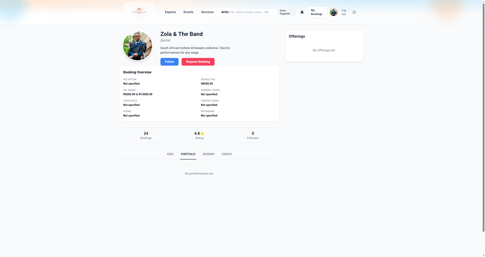
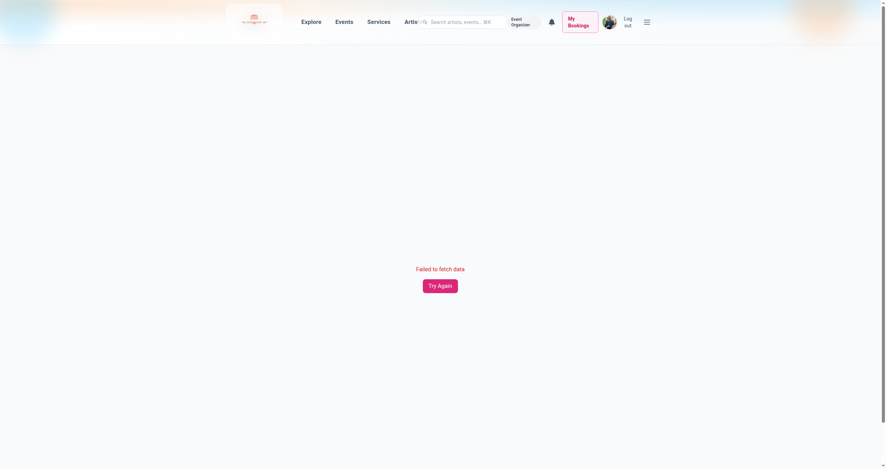

# 🖱️ Driving the booking flow by hand

Walking a booking from request to confirmation, in the browser, as both sides. This is how you
check the marketplace still behaves after a change, and how you see a state you cannot get to any
other way.

Everything here needs the stack up ([Stack § 1](../running-the-web-app/bringing-the-stack-up.md#1-bring-the-whole-stack-up))
and the data seeded ([Seeding § 1 to 3](../preparing-the-data/seeding-and-resetting-data.md#1-seed-the-marketplace-providers)).

## Contents

- [1. Submit a booking request as an organizer](#1-submit-a-booking-request-as-an-organizer)
- [2. Answer a request as a provider](#2-answer-a-request-as-a-provider)
- [3. Inspect the seven pre-built scenarios](#3-inspect-the-seven-pre-built-scenarios)
- [4. Walk the whole happy path](#4-walk-the-whole-happy-path)

## 1. Submit a booking request as an organizer

Navigation: 📋 [Contents](#contents) | [Next](#2-answer-a-request-as-a-provider) ➡️

`ran 2026-08-23` up to the booking form; `unverified` past it

Log in as `test_organizer` / `Test123!` at `http://localhost:5173/login`.

1. Go to `/artists`.
   ✅ Verified: 35 artists listed, including all the seeded providers (Zola & The Band, Nandi
   Dlamini, DJ Karabo, The Brass Co., Test Artist), with genre and rating on each card.
2. Click any artist card, for example "Zola & The Band" at `/artists/30`.
   ✅ Verified: the profile renders with a Booking Overview panel. Zola shows a default fee of
   `R8500.00` and a range of `R6000.00 to R15000.00`.
3. Click **Request Booking**, which links to `/artists/<id>/book`.
   **The button is called "Request Booking", not "Book Artist".** The old QA guide said the latter
   and no such control exists.
4. Fill in a start date and time in the future, an end two or three hours later, an attendee count
   of 150, and any message.
5. Submit.



✅ Expected past step 3, not yet confirmed: you land on the request detail page, the status badge
reads `Pending`, the provider is shown, and there are **no action buttons** for the organizer. That
absence is correct; the next move belongs to the provider.

❌ No artists on `/artists` means `seed_marketplace` has not run.

❌ The submit fails on availability means slots were never materialized. See
[Seeding § 3](../preparing-the-data/seeding-and-resetting-data.md#3-materialize-availability-slots).

<details>
<summary><b>What a booking request is, as opposed to a booking</b></summary>

The request is the ask; the booking is what exists after the provider says yes. The request carries
a seven-value status covering the whole negotiation, not a yes or no.
See [what a booking request is](../../context/world/booking-request.md).
</details>

## 2. Answer a request as a provider

Navigation: ⬅️ [1. Submit a booking request as an organizer](#1-submit-a-booking-request-as-an-organizer) | 📋 [Contents](#contents) | [Next](#3-inspect-the-seven-pre-built-scenarios) ➡️

`unverified`

Log out, then log in as `test_artist` / `Test123!`.

Open the provider dashboard. Incoming requests are listed with their action buttons.

**Approve.** Click **Approve** on a pending request.
✅ The request status becomes `Approved` and a confirmed booking appears.

**Decline.** Click **Decline**.
✅ The request status becomes `Declined` and no booking is created.

**Counter-propose.** Click **Counter-propose**, change the dates or the rate, add a message,
submit.
✅ The request status becomes `Counter Proposed`, and the organizer now sees a Review and Respond
panel.

**Complete.** On a confirmed booking whose date has passed, click **Complete**.
✅ The booking status becomes `Completed`, which is what unlocks the organizer's review.

> 📷 **Screenshot wanted**: the provider dashboard with an incoming request and its action buttons
> visible. Save as `images/booking/02-provider-dashboard.png`.

❌ No notification reaches the organizer after any of these. That is expected and is a known gap,
not a fault in this recipe: see [Stack § 4](../running-the-web-app/bringing-the-stack-up.md#4-drain-the-outbox).

## 3. Inspect the seven pre-built scenarios

Navigation: ⬅️ [2. Answer a request as a provider](#2-answer-a-request-as-a-provider) | 📋 [Contents](#contents) | [Next](#4-walk-the-whole-happy-path) ➡️

`ran 2026-08-23` ⚠️ **This recipe cannot be completed today. The page it opens is broken.**

Log in as `test_organizer` and click **My Bookings** in the navbar, which goes to
`/dashboard/organizer`.

❌ **What actually happens:** the page renders "Failed to fetch data" with a Try Again button, and
the console shows two 404s.



```
Failed to load resource: the server responded with a status of 404 (Not Found)
  @ http://localhost:5173/api/events/my/
```

**The cause is a one-word path mismatch.** The backend registers `my-events/`
(`events/api_urls.py:14`), so the working endpoint is `/api/events/my-events/`, which returns 401
for an unauthenticated call, meaning the route exists. The frontend asks for `/api/events/my/`,
which does not exist. Two files call the wrong path:

```
frontend/src/EventOrganizerDashboard.jsx:252      fetch('/api/events/my/', { headers })
frontend/src/components/booking/EventSelector.jsx:21   fetch('/api/events/my/', {
```

This is not a setup problem and re-seeding will not fix it. Until those two paths are corrected,
the organizer dashboard and the event selector cannot load.

✅ Once fixed, all seven rows should be present with these statuses:

| Label | Event | Provider | Expected status |
|---|---|---|---|
| A | Afrobeats Night | Zola & The Band | `Pending` |
| B | Jazz Under the Stars | Nandi Dlamini | `Counter Proposed` |
| C | House Music Festival | DJ Karabo | confirmed booking |
| D | New Year's Eve Gala | The Brass Co. | completed, with a ★★★★★ review |
| E | Corporate Gala Dinner | Feast Cape Town | `Declined` |
| F | Tech Conference Afterparty | Luminary Productions | `Withdrawn` |
| G | Demo Event, Live Test | Test Artist | `Pending` |

Click into each row. The detail page should render with the right status badge and only the actions
that status allows.

The seven scenarios do exist: `seed_booking_workflow` reported all seven present on 2026-08-23. The
data is fine; only the page that displays it is broken.

> 📷 **Screenshot wanted**, once the path is fixed: the Marketplace Requests tab showing all seven
> rows with their status badges. Save as `images/booking/03-seven-scenarios.png`.

❌ Fewer than seven rows, or wrong statuses, means the seed is stale. Re-run with `--clear`; see
[Seeding § 2](../preparing-the-data/seeding-and-resetting-data.md#2-seed-the-booking-scenarios).

## 4. Walk the whole happy path

Navigation: ⬅️ [3. Inspect the seven pre-built scenarios](#3-inspect-the-seven-pre-built-scenarios) | 📋 [Contents](#contents)

`unverified`

The full round trip, both sides, when you want to prove the flow rather than one screen. Budget
about fifteen minutes.

1. As `test_organizer`, submit a request ([recipe 1](#1-submit-a-booking-request-as-an-organizer)).
2. As `test_artist`, counter-propose it with different dates
   ([recipe 2](#2-answer-a-request-as-a-provider)).
3. As `test_organizer`, open the request and click **Accept counter-proposal**.
   ✅ The request becomes `Approved` and you are redirected to `/booking-detail/<id>` showing
   `Confirmed`.
4. As `test_organizer`, click **Reschedule**, pick new times, submit.
   ✅ The booking becomes `Reschedule Pending`; the provider must confirm.
5. As `test_artist`, confirm the reschedule, then **Complete** the booking.
6. As `test_organizer`, open the completed booking, click **Leave a review**, pick a rating and
   write a comment.
   ✅ A "Review submitted" confirmation appears and the stars show on the booking detail.

❌ Any step where the expected button is missing: check which user you are logged in as. The
actions available are role-dependent and the two roles see different pages for the same booking.

<details>
<summary><b>Why the organizer has no buttons at step 1</b></summary>

A pending request is waiting on the provider. The organizer's only move is to withdraw it, which
sits at the bottom of the detail page rather than among the primary actions, because withdrawing is
rare and destructive to a negotiation in progress.
</details>
