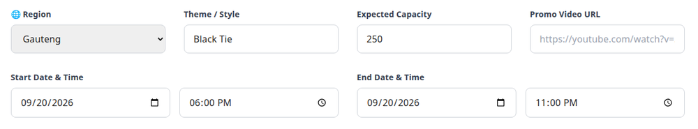
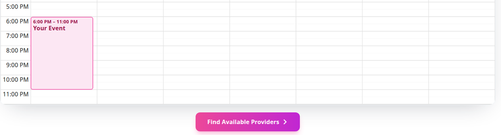
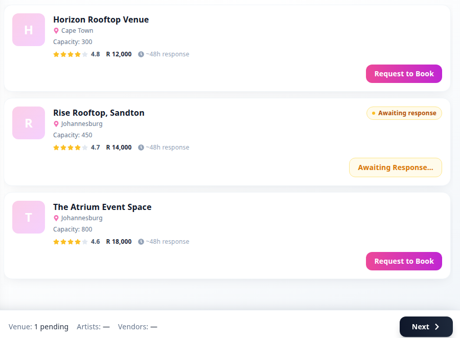
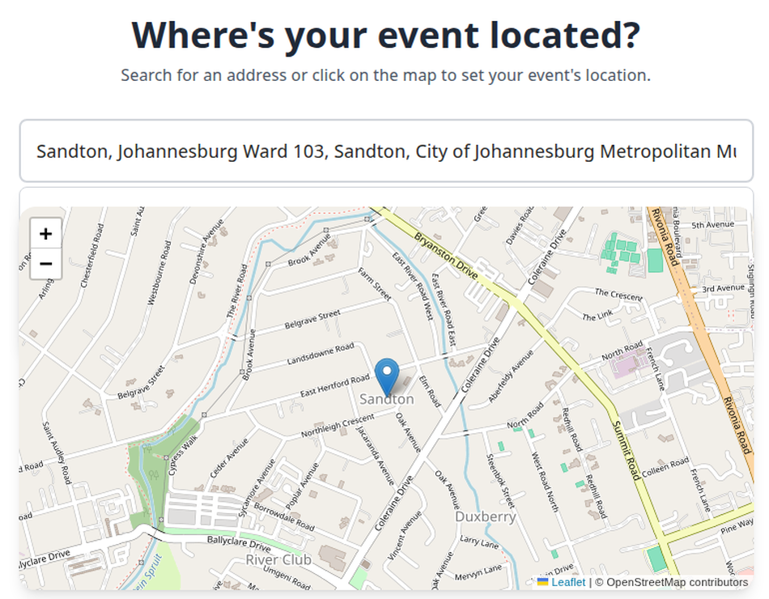
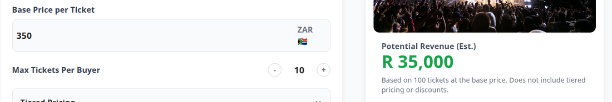
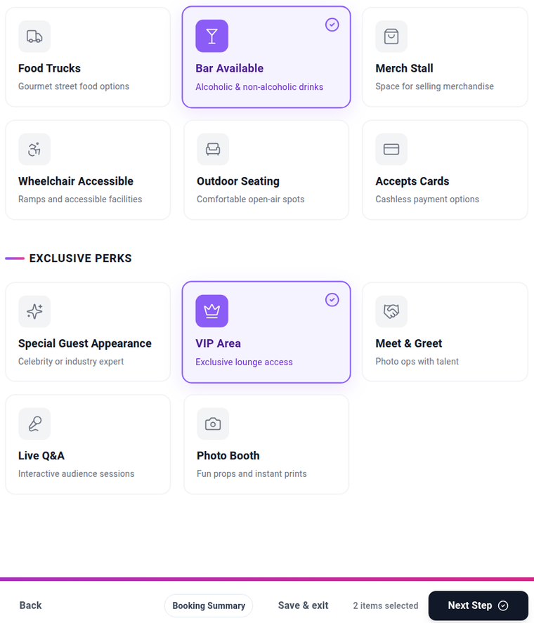
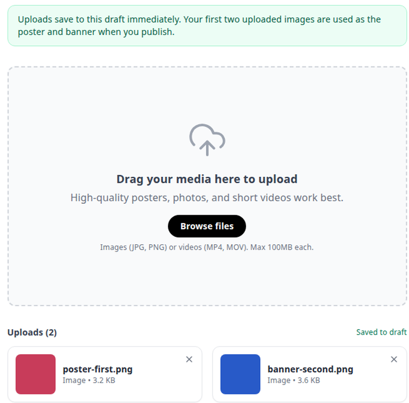
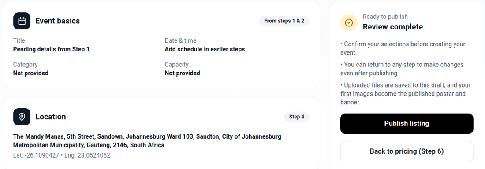
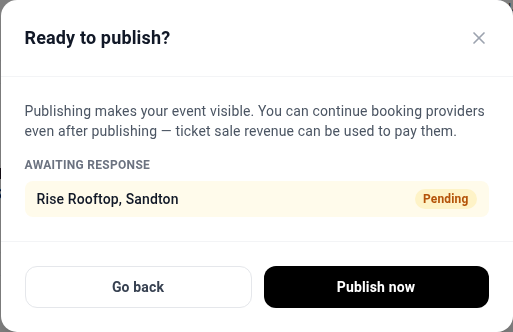

# 🧭 Walking the event wizard

Driving the create-event flow in the browser as an organizer, from an empty draft through to a
published event, with the booking requests that came with it. One place your hands are: `http://localhost:5173`, logged in as an
organizer, with a second window on `sqlite3` so you can see what each screen actually wrote.

What the provider does with the request afterwards is
[Driving the booking flow](driving-the-booking-flow.md). What the wizard's screens send to the
backend, request by request, was recorded live in
[the event-creation flow map](/home/molef/goal-setting/learning/attica-event-creation/flow-map.md);
this file is the shorter thing you follow by hand.

Two system facts every recipe here leans on: the frontend reaches the backend down
[two different paths](../../environment/overview.md#access-paths), and a provider only appears in
search when [five rows line up](../../environment/django-admin/scheduling-availability.md).

<details>
<summary><b>How the wizard stores what you type</b></summary>

**There is one row, and it is not an event**

Every screen of the wizard edits a single `events_eventdraft` row. That row carries a JSON `data`
column with a `steps` object inside it, and each screen adds one key: `step1`, `step3`, and so on.
A real `events_event` row is created only when you publish at the end.

**So a half-finished wizard is a draft row with some keys missing**

Reading the draft row back is the fastest way to tell what a screen saved and what it silently
dropped. Every recipe below pairs the screen with that read.

**Booking requests live somewhere else entirely**

Asking a provider for a time window writes to the `scheduling_*` tables, not into the draft. The
draft only picks up the request id later, when you click Next off the marketplace screen.

</details>

## Table of contents

The recipes are numbered so the index and anything you pasted elsewhere keep resolving. The numbers
are addresses, not an order: start at whichever one answers your question. Recipe 1 and recipe 4 are
the wizard's own path; recipes 2 and 3 are a second way into booking that you reach from My Events.

- [Words this file uses](#words-this-file-uses)
- [Before any of these](#before-any-of-these)
- [The route numbers do not match the screen numbers](#the-route-numbers-do-not-match-the-screen-numbers)
- [1. Fill step 1 so the scheduler has something to search](#1-fill-step-1-so-the-scheduler-has-something-to-search)
- [2. Select artists and open the scheduler](#2-select-artists-and-open-the-scheduler)
- [3. Search availability and send the requests](#3-search-availability-and-send-the-requests)
- [4. Send a booking request from the step3 marketplace](#4-send-a-booking-request-from-the-step3-marketplace)
- [5. Set the location on route step4](#5-set-the-location-on-route-step4)
- [6. Set the ticket price on route step5](#6-set-the-ticket-price-on-route-step5)
- [7. Add features and media before review](#7-add-features-and-media-before-review)
- [8. Publish the draft and check what the event got](#8-publish-the-draft-and-check-what-the-event-got)
- [If something looks wrong](#if-something-looks-wrong)
- [Where this came from](#where-this-came-from)

## Words this file uses

Navigation: 📋 [TOC](#table-of-contents) | [Next](#before-any-of-these) ➡️

- **Draft**: the `events_eventdraft` row the whole wizard edits. It holds your answers as JSON and
  becomes a real event only at publish.
- **Booking request**: a row in `scheduling_bookingrequest`. You asking a provider for a time
  window. It starts at `pending` and expires 48 hours later if nobody answers.
- **Hold**: the window in which an approved request is yours to pay for before it is released. The
  database column is `draft_hold_expires_at` and the API calls the same value
  `checkout_hold_expires_at`. There is one hold, under two names, and nothing in this file creates
  one: it is set when the provider approves.
- **Outbox event**: a row in `scheduling_outboxevent`, written in the same transaction as the thing
  it describes, for a worker to pick up later. Nobody is notified until that worker runs.

## Before any of these

Navigation: ⬅️ [Words this file uses](#words-this-file-uses) | 📋 [TOC](#table-of-contents) | [Next](#the-route-numbers-do-not-match-the-screen-numbers) ➡️

- [ ] 🖥️ **All four processes up.** [Stack § 1](../running-the-web-app/bringing-the-stack-up.md#1-bring-the-whole-stack-up).
  ```bash
  (ss -ltnp || netstat -ltnp) | grep -E ':(8000|5173|6379)'
  ```
  ✅ **Three LISTEN lines, daphne on 8000, vite on 5173, redis on 6379.** Anything missing here
  shows up later as a screen that loads and then does nothing.

- [ ] 🖥️ **The marketplace seeded and at least one provider actually bookable.**
  [Seeding § 1](../preparing-the-data/seeding-and-resetting-data.md#1-seed-the-marketplace-providers)
  then [Seeding § 3](../preparing-the-data/seeding-and-resetting-data.md#3-materialize-availability-slots).
  Bookable is not the same as visible in the catalogue.
  ```bash
  sqlite3 backend/main/db.sqlite3 "select count(*) from scheduling_availabilityslot where is_bookable = 1;"
  ```
  ✅ **A number in the thousands.** `0` means the slots were never materialized and every search
  below returns nothing.

- [ ] 🌐 **Logged in as an organizer** at `http://localhost:5173/login`. The account used throughout
  this file is `e2e-organizer`, user id 82; its password is in
  [Seeding § 4](../preparing-the-data/seeding-and-resetting-data.md#4-the-test-accounts).

- [ ] 🖥️ **A second terminal open at the repository root**, for the database reads each recipe
  pairs with its screen. `sqlite3` reads the development database directly, so nothing needs the
  Django shell.

## The route numbers do not match the screen numbers

Navigation: ⬅️ [Before any of these](#before-any-of-these) | 📋 [TOC](#table-of-contents) | [Next](#1-fill-step-1-so-the-scheduler-has-something-to-search) ➡️

This is the single most confusing thing about driving the wizard, so it is worth reading before you
start clicking. Every route below sits under `/listing/<draft-id>/`.

| Route | What renders | What the screen calls itself | What it writes |
|---|---|---|---|
| `step1` | `ListingStep1.jsx` | **Step 1 of 8** | `steps.step1` on the draft |
| `step2` | nothing, it redirects to `step1` | never seen | nothing |
| `step3` | `ListingStep3.jsx` | **Step 2 of 8** | `steps.step3`, and the `scheduling_*` rows |
| `step4` | `ListingStep4.jsx` | no step label on screen | `steps.step4`, and an empty `{}` on arrival |
| `step5` | `ListingStep5.jsx` | no step label on screen | `steps.step5` |
| `step6` | `ListingStep6.jsx` | **Step 2** | `steps.step6`, always `{}` |
| `step7` | `ListingStep7.jsx` | no step label on screen | `steps.step7` |
| `step8` | `ListingStep8.jsx` | no step label on screen | `events_eventdraftasset`; `steps.step8` stays `{}` |
| `review` | `ListingReview.jsx` | "Review & Publish" | `events_event`, and it re-parents your booking requests |

**Trust the route, never the label.** The URL is what the code branches on
(`frontend/src/App.jsx:118-130`) and what these recipes name. The on-screen number is decoration
that drifted: route `step3` announces itself as "Step 2 of 8", and route `step6` announces itself as
plain "Step 2", so two different screens both claim to be step 2.

**`step2` is a dead route, not a screen you pass through.** It is
`<Navigate to="step1" replace/>` at `frontend/src/App.jsx:121`. Saving on route `step1` sends you
straight to route `step3`. A `ListingStep2.jsx` file exists in the source and nothing routes to it.

**Only three screens carry a step label at all.** The rest show a heading and no number, which is
the honest state of the wizard rather than something missing from this table.

**A `stepN` key is not evidence that screen was filled.** Three of them hold an empty `{}` in normal
use: `step4` from the moment you arrive, `step6` always, and `step8` however many files you upload.
Check the contents.

## 1. Fill step 1 so the scheduler has something to search

Navigation: ⬅️ [The route numbers](#the-route-numbers-do-not-match-the-screen-numbers) | 📋 [TOC](#table-of-contents) | [Next](#2-select-artists-and-open-the-scheduler) ➡️

`ran 2026-08-28`

**When you need this**

You want a draft that the availability search will actually work on, because a draft saved without a
usable time range fails two screens later with nothing on screen pointing back here.

**Fill in**

| What | Example | Where to get it |
|---|---|---|
| Start and end date | `2026-09-20` | A date the seeded providers cover. Check with the query below. |
| Start and end time | `18:00` and `23:00` | Any window inside the providers' day. The seeded slots end at 21:00 UTC, which is 23:00 local. |
| Expected Capacity | `250` | Anything. It does not reach the booking request, see the ❌ below. |

🗄️ **Pick a date the seeded data covers, before you type it into the form:**

```bash
sqlite3 -header -column backend/main/db.sqlite3 "
select r.resource_type, count(*) n, min(s.start_at) first_start, max(s.end_at) last_end
from scheduling_availabilityslot s
join scheduling_marketplaceresource r on r.id = s.resource_id
where date(s.start_at) = '2026-09-20' and s.is_bookable = 1
group by r.resource_type;"
```

✅ **A row per provider type, with times in UTC:**

```
resource_type  n  first_start          last_end
-------------  -  -------------------  -------------------
artist         9  2026-09-20 04:47:43  2026-09-20 21:00:00
vendor         4  2026-09-20 06:00:00  2026-09-20 21:00:00
venue          3  2026-09-20 06:00:00  2026-09-20 21:00:00
```

❌ **No rows at all**: that date has no materialized slots. Pick another, or run
[Seeding § 3](../preparing-the-data/seeding-and-resetting-data.md#3-materialize-availability-slots).

🌐 **Then, in the browser:**

1. Go to `http://localhost:5173/createEvent` and click **Get started** in the footer. It creates the
   draft and drops you on `/listing/<new-id>/step1`. The id in the URL is the draft id you will use
   for every read below.
2. Fill **Event Name**, **Description**, **Region**, **Theme / Style**, **Expected Capacity**, and
   all four of **Start Date**, **Start Time**, **End Date**, **End Time**.
3. Click one event-type card (**Concert**).
4. Click **Save & Continue** in the footer.


*Date and time are four separate inputs, not two. Filling the dates and leaving the times empty is
accepted by the form and is the failure that surfaces on route step3.*

✅ **The URL changes to `/listing/<draft-id>/step3`**, skipping `step2` entirely.

🗄️ **What the screen wrote.** Two reads, against the draft id from your URL:

```bash
sqlite3 -header -line backend/main/db.sqlite3 \
  "select id, organizer_id, status, current_step from events_eventdraft where id = 45;"

sqlite3 backend/main/db.sqlite3 \
  "select json_extract(data,'$.steps.step1') from events_eventdraft where id = 45;" \
  | python3 -m json.tool
```

✅ **The row, then everything the form sent:**

```
          id = 45
organizer_id = 82
      status = draft
current_step = step3

{
    "eventName": "Runbook Walk Concert",
    "description": "A test event created while walking the runbook recipe for route step1.",
    "selectedEventType": "Concert",
    "region": "Gauteng",
    "genres": [],
    "tags": [],
    "theme": "Black Tie",
    "startDate": "2026-09-20",
    "startTime": "18:00",
    "endDate": "2026-09-20",
    "endTime": "23:00",
    "capacity": "250",
    "videoUrl": "",
    "additionalNotes": "",
    "name": "Runbook Walk Concert",
    "category": "Concert",
    "guest_count": 250,
    "start_date": "2026-09-20T18:00",
    "end_date": "2026-09-20",
    "start_time": "2026-09-20T18:00",
    "end_time": "23:00",
    "date": "2026-09-20",
    "notes": "A test event created while walking the runbook recipe for route step1."
}
```

**What to notice in the pair.** The form showed you eleven fields and the database holds
twenty-two, because every answer is stored once in camelCase for the form to read back and once in
snake_case for the publish step. `current_step` already says `step3`, so the draft records where you
are going rather than where you were.

**The snake_case half is not a clean copy, and it does not stay still.** Straight after this save
`start_date` and `start_time` both hold `2026-09-20T18:00`, your local form value. Passing through
route `step3` later overwrites both from the scheduler's window in UTC
(`frontend/src/ListingStep3.jsx:174`), so the same draft then reads `start_date`
`2026-09-20T16:00:00.000Z` and `start_time` `18:00`.

So the ✅ block above is what you see at this point in the wizard, not for the rest of the draft's
life. **The camelCase fields are the stable ones**: `startDate` and `startTime` keep what you typed
the whole way through. Read those when you want to know what the organizer actually entered.

⚠️ **A date with no times is the failure that shows up two screens later.** Route `step3` derives its
search window from what this screen saved, and the search runs on `start_at` and `end_at`. Saved
without times, there is no window, the search returns nothing, and no message connects that back
here.

❌ **A field you filled is missing from the JSON**: it is outside `STEP_FIELD_WHITELIST.step1` in
`frontend/src/context/reactContext.jsx` and was dropped on save without a message. Add it to the
whitelist or stop expecting it downstream.

**Variations**

- Check only whether the times survived: `sqlite3 backend/main/db.sqlite3 "select json_extract(data,'$.steps.step1.startTime'), json_extract(data,'$.steps.step1.endTime') from events_eventdraft where id = 45;"`
- List your recent drafts to find the id again: `sqlite3 -header -column backend/main/db.sqlite3 "select id, status, current_step, created_at from events_eventdraft where organizer_id = 82 order by id desc limit 5;"`
- See which top-level keys the draft carries: `sqlite3 backend/main/db.sqlite3 "select group_concat(key, ', ') from events_eventdraft, json_each(events_eventdraft.data) where events_eventdraft.id = 45;"`

<details>
<summary><b>Why the draft is fetched four times when the page opens</b></summary>

**Two components load it, and React runs each of them twice**

The wizard layout and the step page each fetch the draft on mount, and React's development strict
mode double-invokes those effects. Four identical `GET /api/events/event-drafts/<id>/` calls in the
network tab is the normal, healthy shape here, not a bug you have introduced.

**Only the click that created the draft goes cross-origin**

`POST /api/events/event-drafts/` is sent to `http://127.0.0.1:8000` directly, because the client
that makes it hardcodes that base URL. Everything afterwards uses a relative URL through the Vite
proxy on port 5173. Two clients, two paths to the same backend, and only the first one needs CORS to
be right.

</details>

## 2. Select artists and open the scheduler

Navigation: ⬅️ [1. Fill step 1](#1-fill-step-1-so-the-scheduler-has-something-to-search) | 📋 [TOC](#table-of-contents) | [Next](#3-search-availability-and-send-the-requests) ➡️

`unverified`

**When you need this**

You are booking from the standalone scheduler page rather than from inside the wizard.

**Needs first**

You do not reach this screen by walking the wizard. Route `step3` renders its own marketplace
instead, which is [recipe 4](#4-send-a-booking-request-from-the-step3-marketplace). The only thing
in the frontend that links to `step3/artists` is My Events
(`frontend/src/MyEventsPage.jsx:28`), so you arrive here by opening a draft from there.

🌐 Go to `/listing/<draft-id>/step3/artists`. The catalogue loads from `/api/artists/artists`. Tick
the artists you want, then **Open Scheduler** (or **Request to Book All**, which does the same thing
and sets `auto_request=1`).

✅ The URL you land on carries `event_id` and `artist_ids`, which is how the scheduler knows what to
search for. If either is missing from the query string, the selection did not register.

*Nobody has driven this path. The route and the buttons were read out of
`frontend/src/pages/SelectArtists.jsx:71-77`, not clicked.*

## 3. Search availability and send the requests

Navigation: ⬅️ [2. Select artists](#2-select-artists-and-open-the-scheduler) | 📋 [TOC](#table-of-contents) | [Next](#4-send-a-booking-request-from-the-step3-marketplace) ➡️

`unverified`

**When you need this**

You came in through [recipe 2](#2-select-artists-and-open-the-scheduler) and you are on the
standalone `/scheduling` page.

🌐 On `/scheduling`, check the search window matches your event before searching. It autofills from
the event date when no explicit range was passed, and the autofill is the thing to distrust.

Search hits `/api/scheduling/availability/search/`; sending the requests hits
`/api/scheduling/requests/create/`, the same endpoint
[recipe 4](#4-send-a-booking-request-from-the-step3-marketplace) drove.

❌ **No providers in the results.** Almost never the provider record itself. Work through
[Preparing artist availability § 7](../preparing-the-data/preparing-artist-availability.md#7-find-out-why-an-artist-is-not-in-the-search-results),
which walks the five things that have to exist, in dependency order.

❌ **Results appear, and creating the request fails.** That is the policy, not the availability:
`min_notice_hours` defaults to 24 (`backend/main/scheduling/models.py:97`), so a request for
tomorrow is refused at `backend/main/scheduling/services.py:153` after the slot showed as free. See
[the fields that silently block a request](../../environment/django-admin/scheduling-availability.md#the-fields-that-silently-block-a-request).

✅ Requests created. What the provider sees next, and how to answer as them, is
[Driving the booking flow § 2](driving-the-booking-flow.md#2-answer-a-request-as-a-provider).

*Nobody has driven this page. Its two endpoints are named from the source; the identical request
endpoint has been driven, from route `step3`.*

## 4. Send a booking request from the step3 marketplace

Navigation: ⬅️ [3. Search availability](#3-search-availability-and-send-the-requests) | 📋 [TOC](#table-of-contents) | [Next](#5-set-the-location-on-route-step4) ➡️

`ran 2026-08-28`

**When you need this**

You are walking the wizard, you have just saved route `step1`, and you want a real `pending` booking
request in the database so the provider side has something to answer.

**Needs first**

[Recipe 1](#1-fill-step-1-so-the-scheduler-has-something-to-search), saved with all four date and
time fields. This screen has no window of its own; it inherits step1's.

🌐 **Confirm the window.** Saving step1 lands you on `/listing/<draft-id>/step3`, headed
"Confirm your event time window" and labelled **Step 2 of 8**. A pink **Your Event** block is
already placed on the calendar from your step1 dates.


*The block is placed from step1, in the first column of the week, Sunday 20 September. If it is
missing or sits at the wrong hour, go back: step1's times are wrong and searching now wastes the
trip.*

🌐 Click **Find Available Providers**. The calendar shrinks to a strip on the left, a
**Selected Window** panel appears reading "Sun, Sep 20 6:00 PM to Sun, Sep 20 11:00 PM", and the
right side becomes a marketplace with **Venues**, **Artists** and **Vendors** tabs. The Venues tab
is selected and searched for you.

✅ **Provider cards, each with a Request to Book button.** Three, for the seeded venues.

🗄️ **Check the screen against the database.** The search sends your local 18:00 to 23:00 as
16:00 to 21:00 UTC, so the query uses the UTC numbers:

```bash
sqlite3 -header -column backend/main/db.sqlite3 "
select r.id, r.display_name, r.resource_type, count(s.id) as slots
from scheduling_marketplaceresource r
join scheduling_availabilityslot s on s.resource_id = r.id
where r.resource_type = 'venue'
  and r.is_active = 1
  and s.is_bookable = 1
  and s.start_at < '2026-09-20 21:00:00'
  and s.end_at   > '2026-09-20 16:00:00'
group by r.id, r.display_name
order by r.id;"
```

✅ **The same three names the screen showed, with their resource ids:**

```
id  display_name            resource_type  slots
--  ----------------------  -------------  -----
8   The Atrium Event Space  venue          1
9   Horizon Rooftop Venue   venue          1
17  Rise Rooftop, Sandton   venue          1
```

**What to notice in the pair.** The screen shows display names and the database shows ids, and the
id is what the next click sends. Rise Rooftop, Sandton is resource 17, which is the number to look
for in the booking request row below. If the screen lists a venue this query does not, the two are
reading different windows and the culprit is the local-to-UTC conversion.

⚠️ **Request to Book writes four rows and cannot be undone from the screen.** Count them first, so
you can tell afterwards exactly what the click did:

```bash
for t in scheduling_bookingrequest scheduling_auditlog scheduling_outboxevent \
         notifications_notification scheduling_checkoutsession scheduling_booking; do
  printf "%-30s %s\n" "$t" "$(sqlite3 backend/main/db.sqlite3 "select count(*) from $t;")"
done
```

✅ **Six counts. Write them down.** The run these numbers came from:

```
scheduling_bookingrequest      28
scheduling_auditlog            31
scheduling_outboxevent         31
notifications_notification     54
scheduling_checkoutsession      0
scheduling_booking              2
```

🌐 **Now click Request to Book** on one card. Only one venue can be held at a time, and the screen
says so above the cards: booking a second venue in an overlapping window cancels the first
(`backend/main/scheduling/services.py:426`).


*The card you clicked swaps its pink Request to Book button for a pale Awaiting Response, and the
footer chip flips from `Venue: —` to `Venue: 1 pending`. The other two cards stay clickable, which
is what the exclusivity warning above them is about.*

✅ **`POST /api/scheduling/requests/create/` returns 201**, the card reads Awaiting response, and
the Booking Summary button in the top bar gains a `1` badge.

🗄️ **Read the four rows the click wrote.** Run the same six counts again first:

✅ **Exactly one new row in four tables, and nothing in the other two:**

```
scheduling_bookingrequest      29     (+1)
scheduling_auditlog            32     (+1)
scheduling_outboxevent         32     (+1)
notifications_notification     55     (+1)
scheduling_checkoutsession      0     (unchanged)
scheduling_booking              2     (unchanged)
```

Then read them:

```bash
sqlite3 -header -line backend/main/db.sqlite3 "
select id, event_draft_id, event_id, organizer_id, resource_id, status,
       requested_start_at, requested_end_at, attendee_count,
       expires_at, draft_hold_expires_at, checkout_session_id, idempotency_key
from scheduling_bookingrequest order by id desc limit 1;"

sqlite3 -header -line backend/main/db.sqlite3 \
  "select id, action, actor_id, target_type, target_id from scheduling_auditlog order by id desc limit 1;"

sqlite3 -header -line backend/main/db.sqlite3 \
  "select id, event_type, status from scheduling_outboxevent order by id desc limit 1;"

sqlite3 -header -line backend/main/db.sqlite3 \
  "select id, recipient_id, notification_type, title, is_read from notifications_notification order by id desc limit 1;"
```

✅ **The request, then its three companions:**

```
                   id = 38
       event_draft_id = 45
             event_id =
         organizer_id = 82
          resource_id = 17
               status = pending
   requested_start_at = 2026-09-20 16:00:00
     requested_end_at = 2026-09-20 21:00:00
       attendee_count = 1
           expires_at = 2026-08-30 07:03:43.404373
draft_hold_expires_at =
  checkout_session_id =
      idempotency_key = request-8e78398c-6119-4c13-8f50-c62e4c284c49

         id = 32
     action = request.created
   actor_id = 82
target_type = BookingRequest
  target_id = 38

        id = 32
event_type = request.created
    status = pending

               id = 55
     recipient_id = 79
notification_type = booking_request
            title = New booking request for Rise Rooftop, Sandton
          is_read = 0
```

**What to notice in the pair.** `resource_id` is 17, the id the venue query gave for the card you
clicked. `event_id` is empty and `event_draft_id` is 45, because no event exists yet. The times are
stored in UTC, 16:00 to 21:00, against the 6 PM to 11 PM the screen showed you. `expires_at` is
48 hours out, and that clock is already running.

**`attendee_count` is 1, not the 250 you typed into step1.** The capacity from step1 never reaches
the request, so any provider policy that checks headcount is checking against 1.

**Neither `checkout_session_id` nor `draft_hold_expires_at` is set, and neither table moved.**
Requesting reserves nothing. The hold and the checkout session are both created later, when the
provider approves, at `backend/main/scheduling/services.py:805`.

**The provider has not been told.** The outbox row sits at `pending` until a worker drains it, and
the notification is a database row that the provider's client will find the next time it polls.

❌ **No provider cards after Find Available Providers.** Almost never the provider record. Work
through [Preparing artist availability § 7](../preparing-the-data/preparing-artist-availability.md#7-find-out-why-an-artist-is-not-in-the-search-results),
which walks the five things that have to line up, in dependency order. Run the venue query above
first: if it returns rows and the screen does not, the problem is the window, not the data.

❌ **Cards appear, and Request to Book fails.** That is the policy, not the availability.
`min_notice_hours` defaults to 24 (`backend/main/scheduling/models.py:97`), so a request for
tomorrow is refused at `backend/main/scheduling/services.py:153` after the slot showed as free. See
[the fields that silently block a request](../../environment/django-admin/scheduling-availability.md#the-fields-that-silently-block-a-request).

**Variations**

- Watch the request from the provider's side instead: [Driving the booking flow § 2](driving-the-booking-flow.md#2-answer-a-request-as-a-provider).
- List every request on this draft: `sqlite3 -header -column backend/main/db.sqlite3 "select id, resource_id, status, requested_start_at, expires_at from scheduling_bookingrequest where event_draft_id = 45;"`
- See how much of the 48 hours is left: `sqlite3 backend/main/db.sqlite3 "select id, round((julianday(expires_at) - julianday('now')) * 24, 1) || ' hours left' from scheduling_bookingrequest where status = 'pending';"`
- Search the Artists or Vendors tab instead: same screen, same endpoint, `resource_type=artist` or `vendor`. Not driven; only the Venues tab was exercised.

<details>
<summary><b>What one Request to Book click actually does, and what it does not</b></summary>

**Four writes in one transaction, and no reservation**

The handler is `CreateRequestAPIView` at `backend/main/scheduling/views.py:454`, which delegates to
`create_request` at `backend/main/scheduling/services.py:386`. It checks that you own the draft,
checks venue exclusivity, checks the provider's policy, and then writes the request, an audit log
entry, an outbox event and a notification together. Nothing about the provider's capacity changes,
so a second organizer can request the same window a second later.

**The hold has two names and one meaning**

`draft_hold_expires_at` on the request is the same value the API returns as
`checkout_hold_expires_at`. It is set only in `approve_request`
(`backend/main/scheduling/services.py:805`), alongside the checkout session, which is why both are
empty on a request you have only just sent. The two management commands `expire_draft_holds` and
`expire_checkout_holds` are byte-identical files and both call `expire_checkout_sessions`, so there
is one hold and one expiry path, not two.

**The idempotency key protects against the network, not against you**

A fresh key is generated on every click, so clicking Request to Book twice in a row creates two
requests. The key only collapses a single click that the browser retried.

</details>

## 5. Set the location on route step4

Navigation: ⬅️ [4. Send a booking request](#4-send-a-booking-request-from-the-step3-marketplace) | 📋 [TOC](#table-of-contents) | [Next](#6-set-the-ticket-price-on-route-step5) ➡️

`ran 2026-08-28`

**When you need this**

You are past the marketplace and the wizard will not let you go further until the map has a
location on it.

**Needs first**

[Recipe 4](#4-send-a-booking-request-from-the-step3-marketplace), or at least a pass through route
`step3`. You cannot reach `step4` from the calendar view: the wizard's **Next** button only appears
after you have clicked **Find Available Providers**.

🌐 On `/listing/<draft-id>/step4`, headed "Where's your event located?". Type into
**Start typing an address...**, wait for the dropdown, and click a suggestion. The pin moves and
**Next** becomes clickable.


*Next stays disabled until a location is set, so this screen is a hard gate. The address box is
also the thing that quietly changes underneath you, see the warning below.*

⚠️ **Read the address box again immediately before you click Next.** Whatever it says at that
instant is what gets saved, and the box rewrites itself without you touching it.

Two things write to it. On arrival the screen asks the browser for your location
(`frontend/src/ListingStep4.jsx:43`) and, when that resolves, overwrites the address and the pin
with wherever it thinks you are (`ListingStep4.jsx:51`). There is no check for a choice you have
already made. It is a network round-trip, so it can land seconds after you have picked an address.
Clicking on the map does the same thing through a different path.

🗄️ **Check what was actually saved:**

```bash
sqlite3 backend/main/db.sqlite3 \
  "select json_extract(data,'$.steps.step4') from events_eventdraft where id = 45;" \
  | python3 -m json.tool
```

✅ **A lat, a lon and an address, matching the box at the moment you clicked:**

```json
{
    "location": {
        "lat": -26.1090427,
        "lon": 28.0524052,
        "address": "The Mandy Manas, 5th Street, Sandown, Johannesburg Ward 103, Sandton, City of Johannesburg Metropolitan Municipality, Gauteng, 2146, South Africa"
    }
}
```

**What to notice in the pair.** The saved address matched the box exactly, and in an earlier run of
this same recipe it saved an address 90 km away in Emfuleni while the pin still showed Sandton,
because the geolocation callback landed between the pick and the click. The screen is truthful at
the instant you read it and not a moment longer.

❌ **The address is somewhere you have never been.** That is the geolocation overwrite. Retype the
address, wait a few seconds for the box to settle, then pick the suggestion and click Next promptly.

**A `step4` key appears the moment you arrive, before you touch anything.** It is created empty, so
the key existing tells you nothing about whether the screen was filled. Check the contents, not the
key.

**Variations**

- Check only the saved address: `sqlite3 backend/main/db.sqlite3 "select json_extract(data,'$.steps.step4.location.address') from events_eventdraft where id = 45;"`
- Find drafts where step4 was reached but never filled: `sqlite3 backend/main/db.sqlite3 "select id from events_eventdraft where json_extract(data,'$.steps.step4') = '{}';"`

## 6. Set the ticket price on route step5

Navigation: ⬅️ [5. Set the location](#5-set-the-location-on-route-step4) | 📋 [TOC](#table-of-contents) | [Next](#7-add-features-and-media-before-review) ➡️

`ran 2026-08-28`

**When you need this**

You want a price on the event, and you want to know which of the numbers on this screen actually
gets stored.

🌐 On `/listing/<draft-id>/step5`, headed "Set your ticket price and options". Set
**Base Price per Ticket**, and leave or change **Max Tickets Per Buyer**, **Refund Policy**, and the
**Seating** and **Access** toggles. Click **Next**. Nothing is gated here.


*The Potential Revenue panel multiplies your price by a fixed 100, not by the capacity you set in
step1. At 250 capacity and R350 it still says R 35,000.*

🗄️ **What the screen wrote:**

```bash
sqlite3 backend/main/db.sqlite3 \
  "select json_extract(data,'$.steps.step5') from events_eventdraft where id = 45;" \
  | python3 -m json.tool
```

✅ **Eight fields, all snake_case:**

```json
{
    "base_price": 350,
    "currency": "ZAR",
    "max_tickets_per_buyer": 10,
    "refund_policy": "full",
    "custom_policy": null,
    "is_seated": false,
    "is_age_restricted": false,
    "access_type": "public"
}
```

**What to notice in the pair.** There is no ticket-quantity field anywhere in what was saved, so the
"100 tickets" the revenue panel is based on has no stored counterpart. The estimate is decoration
and nothing downstream reads it. Unlike step1, this screen stores each value once, in snake_case
only.

## 7. Add features and media before review

Navigation: ⬅️ [6. Set the ticket price](#6-set-the-ticket-price-on-route-step5) | 📋 [TOC](#table-of-contents) | [Next](#8-publish-the-draft-and-check-what-the-event-got) ➡️

`ran 2026-08-28`

**When you need this**

You are on the last stretch before review and you want the poster and banner to come out in the
right order.

🌐 **Route `step6` is a pass-through.** It is headed "Make your event stand out", is labelled
**Step 2** on screen, has no fields, and its only action is **Next**.

🗄️ It is not free, though. Leaving it writes an empty object and advances the draft:

```bash
sqlite3 backend/main/db.sqlite3 \
  "select json_extract(data,'$.steps.step6'), current_step from events_eventdraft where id = 45;"
```

✅ **`{}|step7`.** The interstitial persists nothing of its own but still costs a save, and still
leaves a `step6` key behind that looks exactly like a filled step.

🌐 **Route `step7`, "What does your event offer?"** Click the amenity and perk cards you want. A
selected card turns purple with a tick and the footer counts them. Click **Next Step** (this screen
labels the button differently from every other one).


*Selected means purple with a tick in the corner. The footer count is the quickest check that a
click registered.*

✅ **What it saved, which is the labels themselves, not ids:**

```bash
sqlite3 backend/main/db.sqlite3 "select json_extract(data,'$.steps.step7') from events_eventdraft where id = 45;"
```

```json
{"features": ["Bar Available", "VIP Area"]}
```

🌐 **Route `step8`, "Add photos & video for your event".** Click **Browse files** and pick your
images. **Order matters: the first image you upload becomes the event poster and the second becomes
the banner.**


*"Saved to draft" appears as soon as the upload finishes. These files are already in the database
before you click Next, unlike every other screen in the wizard.*

🗄️ **Confirm they landed, without clicking Next:**

```bash
sqlite3 -header -column backend/main/db.sqlite3 \
  "select id, name, mime_type, size, created_at from events_eventdraftasset where draft_id = 45 order by id;"
```

✅ **One row per file, in upload order, with your original filenames kept:**

```
id  name               mime_type  size  created_at
--  -----------------  ---------  ----  --------------------------
6   poster-first.png   image/png  3326  2026-08-28 12:26:26.008861
7   banner-second.png  image/png  3708  2026-08-28 12:26:26.071131
```

The files themselves sit under
`backend/main/media/event_draft_assets/organizer_<id>/draft_<id>/media/`, renamed to a random hex
string. The `name` column is the only place the original filename survives.

**What to notice in the pair.** `steps.step8` stays `{}` however many files you upload, because the
media lives entirely in `events_eventdraftasset`. That is the third screen whose `stepN` key is an
empty object, alongside `step4` on arrival and `step6`. **An empty `{}` is normal and a `stepN` key
is not evidence that a screen was filled.**

**Variations**

- Count what a draft has uploaded: `sqlite3 backend/main/db.sqlite3 "select count(*) from events_eventdraftasset where draft_id = 45;"`
- See which file will become the poster: `sqlite3 backend/main/db.sqlite3 "select name from events_eventdraftasset where draft_id = 45 order by id limit 1;"`

## 8. Publish the draft and check what the event got

Navigation: ⬅️ [7. Add features and media](#7-add-features-and-media-before-review) | 📋 [TOC](#table-of-contents) | [Next](#if-something-looks-wrong) ➡️

`ran 2026-08-28`

**When you need this**

You want a real, published event row, and you want to know what survived the trip from the draft.

🌐 On `/listing/<draft-id>/review`, headed "Confirm your event details".

**Ignore the empty Event basics block.** It reads "Pending details from Step 1", "Not provided" for
Category and Capacity, and "Add schedule in earlier steps", even when step1 was filled in
correctly and the values are sitting in the database.


*Event basics is blank while Location, Features and Media right beside it are correct. The panel
still says "Review complete". Publishing anyway produces an event with all the missing values
present.*

<details>
<summary><b>Why the review screen cannot show your event basics</b></summary>

**It reads the wrong object, and its fallback can never fire**

The block renders from `eventDetails`, a top-level key on the draft. Step1 fills that in memory and
then saves it as `{}`, so after any page reload the values are gone from it. They are never lost
from `steps.step1`, which is where the publish endpoint reads them.

`ListingReview.jsx:183` does try to fall back to `steps.step1`, but the guard above it returns
`reviewDetails` whenever that is an object, and `reviewDetails` is initialised to `{}` at line 138.
An empty object is truthy, so the guard always passes and the fallback on line 185 is unreachable.

**Which is why publishing anyway is safe**

The backend never looks at `eventDetails`. Confirm it by comparing the published event row against
`steps.step1`, which is what the ✅ block below does.

</details>

⚠️ **Publishing creates a real event row and re-parents your booking requests. Count first:**

```bash
for t in events_event scheduling_bookingrequest scheduling_booking; do
  printf "%-30s %s\n" "$t" "$(sqlite3 backend/main/db.sqlite3 "select count(*) from $t;")"
done
sqlite3 -header -column backend/main/db.sqlite3 \
  "select id, status, event_draft_id, event_id from scheduling_bookingrequest where event_draft_id = 45;"
```

🌐 Click **Publish listing**. This does not publish. It opens a **Ready to publish?** modal that
lists every provider still owed an answer. Click **Publish now** in the modal to actually publish.


*A pending request does not block publishing. The modal names it and lets you go ahead, which is
the answer to "do I have to wait for the venue first".*

✅ **The draft flips and one event row appears:**

```bash
sqlite3 -header -line backend/main/db.sqlite3 "select id, status, published_at from events_eventdraft where id = 45;"
sqlite3 -header -line backend/main/db.sqlite3 "select id, name, category, guest_count, theme, start_date, end_time, base_price, currency, is_draft, image_url, banner_image from events_event order by id desc limit 1;"
```

```
          id = 45
      status = published
published_at = 2026-08-28 12:29:56.143450

           id = 48
         name = Runbook Walk Concert
     category = Concert
  guest_count = 250
        theme = Black Tie
   start_date = 2026-09-20 16:00:00
     end_time = 23:00:00
   base_price = 350
     currency = ZAR
     is_draft = 0
    image_url = .../draft_45/media/2641303e93ef4aa3856f2fbe51bd4a35.png
 banner_image = .../draft_45/media/28b668400f244e9db869fdac5eddd5a9.png
```

**What to notice in the pair.** Every value the review screen called "Not provided" is on the event:
the name, the category, the capacity of 250, the theme. `image_url` is the first file you uploaded
and `banner_image` is the second, so the upload order really does decide poster and banner. The
pricing from step5 is carried across whole.

❌ **`location_id` and `venue` are both empty on the event.** The address you set on route `step4`
stays on the draft and does not reach the published event. Read it from
`steps.step4.location` if you need it.

❌ **Your request query returns nothing after publishing.** Publish clears `event_draft_id` and sets
`event_id` instead, so search by the new event id:

```bash
sqlite3 -header -line backend/main/db.sqlite3 \
  "select id, status, event_draft_id, event_id from scheduling_bookingrequest where event_id = 48;"
```

```
            id = 38
        status = pending
event_draft_id =
      event_id = 48
```

The request keeps its `pending` status and its original 48-hour expiry across the publish. Nothing
about publishing tells the provider anything.

**Variations**

- Find the event a draft became: `sqlite3 backend/main/db.sqlite3 "select id, name, created_at from events_event where organizer_id = 82 order by id desc limit 3;"`
- Compare what published against what the draft held: `sqlite3 backend/main/db.sqlite3 "select json_extract(data,'$.steps.step1.eventName'), json_extract(data,'$.steps.step1.capacity') from events_eventdraft where id = 45;"`

## If something looks wrong

Navigation: ⬅️ [4. Send a booking request](#4-send-a-booking-request-from-the-step3-marketplace) | 📋 [TOC](#table-of-contents) | [Next](#where-this-came-from) ➡️

**A screen loads and then nothing happens when you click.** Check the four processes before
anything else: [Stack § 3](../running-the-web-app/bringing-the-stack-up.md#3-find-out-why-half-the-app-is-failing).

**Nobody is ever notified.** Expected: the outbox rows accumulate until a worker drains them. See
[Stack § 4](../running-the-web-app/bringing-the-stack-up.md#4-drain-the-outbox).

**The wizard shows values you did not type.** The context mirrors itself to `localStorage` under
`eventCreationStore` on every render, and local values win over the backend's when the draft is
loaded. Clear that key and reload to see what the database actually holds.

**Two screens both claim to be step 2.** They do. See
[the route table](#the-route-numbers-do-not-match-the-screen-numbers).

**Opening a draft bounces you to `/createEvent`.** Your access token expired while you were away.
The refresh runs, but the draft fetch has already come back 401 and the wizard gives up. Navigate to
the same URL a second time and it loads. Nothing is lost.

**The review screen says your event has no title, category or capacity.** A display bug, not data
loss. Publish anyway and check the event row. See
[recipe 8](#8-publish-the-draft-and-check-what-the-event-got).

**A booking request you could see a minute ago has vanished.** You published. Publishing clears
`event_draft_id` and sets `event_id`, so query by the event id instead. See
[recipe 8](#8-publish-the-draft-and-check-what-the-event-got).

**The address on route step4 is not the one you chose.** The screen asks the browser where you are
and overwrites your pick when that answer arrives. See
[recipe 5](#5-set-the-location-on-route-step4).

## Where this came from

Navigation: ⬅️ [If something looks wrong](#if-something-looks-wrong) | 📋 [TOC](#table-of-contents)

| What | How it was established | When |
|---|---|---|
| Recipe 1 and recipe 4, end to end | Driven in a browser against the live stack as `e2e-organizer`, creating draft 45 and booking request 38. Every ✅ block is that run's real output. | 2026-08-28 |
| The four screenshots | Captured during that run and cropped to the panel each one is about | 2026-08-28 |
| Every database pane | Run with `sqlite3` against `backend/main/db.sqlite3` immediately after the click above it | 2026-08-28 |
| The route table | Read from `frontend/src/App.jsx:118-130`; the three step labels from `ListingStep1.jsx:288`, `ListingStep3.jsx:350`, `ListingStep6.jsx:57` | 2026-08-28 |
| `attendee_count` is 1, not the step1 capacity | Read off booking request 38 after driving it | 2026-08-28 |
| The hold is one thing under two names | `serializers.py:268` aliases the column; `expire_draft_holds.py` and `expire_checkout_holds.py` are byte-identical and both call `expire_checkout_sessions` | 2026-08-28 |
| Recipes 5 to 8, end to end | Driven in the same browser session, carrying draft 45 through routes step4, step5, step6, step7, step8 and review, and publishing it as event 48. Every ✅ block is that run's real output. | 2026-08-28 |
| The five later screenshots | Captured during that run and cropped to the panel each one is about | 2026-08-28 |
| step3 rewriting step1's snake_case dates | Same draft read after step1 and again after publish, then `frontend/src/ListingStep3.jsx:174` | 2026-08-28 |
| The step4 address being overwritten | Watched happen twice: once losing a Sandton pick to an Emfuleni address, once holding. Mechanism read at `frontend/src/ListingStep4.jsx:43-56` | 2026-08-28 |
| The review screen's blank Event basics | Compared the rendered screen against `steps.step1` in the database, then read `ListingReview.jsx:138` and `:183-186` | 2026-08-28 |
| Publish re-parents requests | Read request 38 before and after clicking Publish now | 2026-08-28 |
| The location not reaching the event | `location_id` and `venue` both empty on event 48 while `steps.step4.location` still holds the address | 2026-08-28 |
| Recipes 2 and 3 | Read out of `frontend/src/pages/SelectArtists.jsx` and the original data-preparation guide. Not driven. | 2026-08-23 |
| The Artists and Vendors marketplace tabs | Not driven. Only the Venues tab has been exercised. | |
